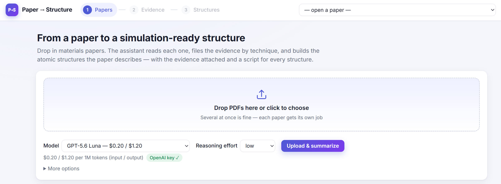
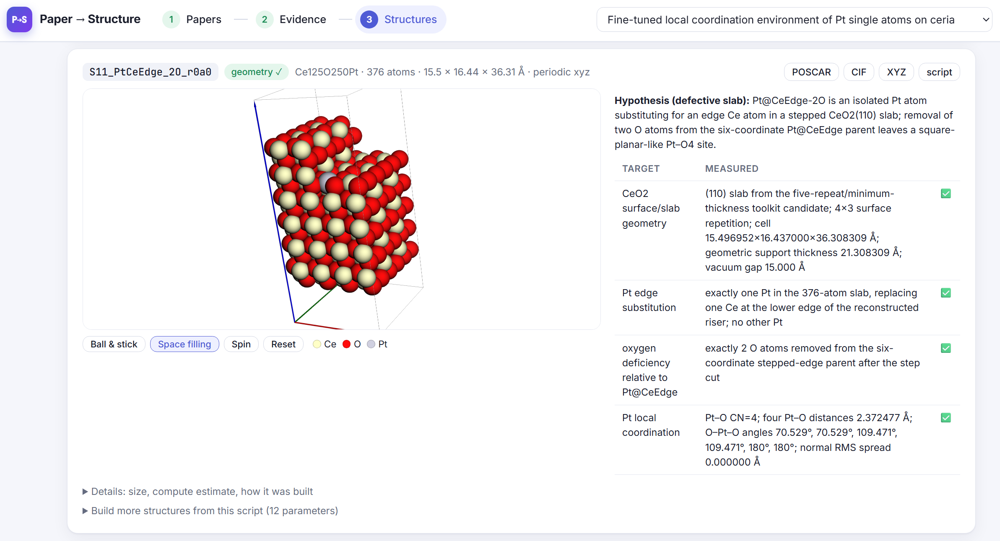
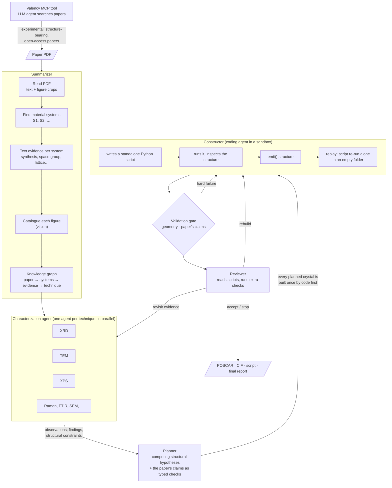

# Paper2Structure — From an experimental materials paper to simulation-ready atomistic structures





Paper2Structure is a multi-agent workflow (Pydantic AI + pydantic-graph), which reads a paper the way a materials scientist would: what was made, what each measurement shows, and what that implies about the atomic structure. 

It then writes and runs the code that builds that structure and checks the result against the paper's own claims. Every structure comes
with the standalone Python script that generated it, so anyone can rebuild it, inspect it or change it.


## Quick start

For Linux with an NVIDIA GPU:

```bash
git clone https://github.com/sj-cha/paper2structure.git && cd paper2structure
conda env create -f environment.yml && conda activate paper2structure
echo 'OPENAI_API_KEY=sk-...' > .env      # GOOGLE_API_KEY=... for Gemini models
```

```bash
# full pipeline -> runs/paper_<time>/
python main.py --config config/config.yml --pdf paper.pdf --random_seed 0    

# analyze only these techniques
python main.py --config config/config.yml --pdf paper.pdf --random_seed 0 --techniques XRD TEM  

# web tool: http://127.0.0.1:8600
python app/server.py                                                 
```

On macOS, install without `torch`, `warp-lang` and `nvalchemi-toolkit-ops` and set
`construction.sandbox: none`: the agent's code then runs **unsandboxed** under your user.


## The pipeline at a glance



### What you get

```
runs/<paper>_<time>/
├── paper/                    paper_graph.json, figure crops, summary.md
├── characterization/XRD.json observations, findings, structural constraints    
├── plans.json                plans, assumptions, claim checks
├── structures/
│   ├── <id>.vasp / .cif      the structure (POSCAR, CIF, extxyz)
│   ├── <id>.py               ← the standalone script that rebuilds it
│   └── <id>.png              top and side views
├── validation_reports.json   every check on every structure
└── final_report.md           what was built, why, how well it matches, what to do next
```

## Key novelties

- **End to end from the paper itself:** the PDF, figures included, becomes a structure traceable to
  specific statements and figures of *that* paper.
- **Claims become tests:** every structural claim of the paper is turned into a typed check that
  code evaluates, or listed as uncheckable with the reason.
- **A coding agent instead of a fixed builder:** system-agnostic pipeline powered by agent reasoning: core–shell particles, supported clusters, interfaces, defects, hybrid perovskites and adsorbates on slabs all go through the same path.
- **Reproducibility enforced:** a structure only counts if the generated script rebuilds it exactly.

## Impact

- **Time and cost:** a literature-based model in minutes and a few cents instead of hours or days.
- **Trust:** every structure ships with its script, its evidence trail and a report of assumptions and deviations.
- **Data:** validated, reproducible structures tied to real experimental papers.
- **Closing the loop:** literature search (Valency), characterization and simulation in one
  pipeline, a step toward autonomous materials discovery.

## License
MIT (see LICENSE).