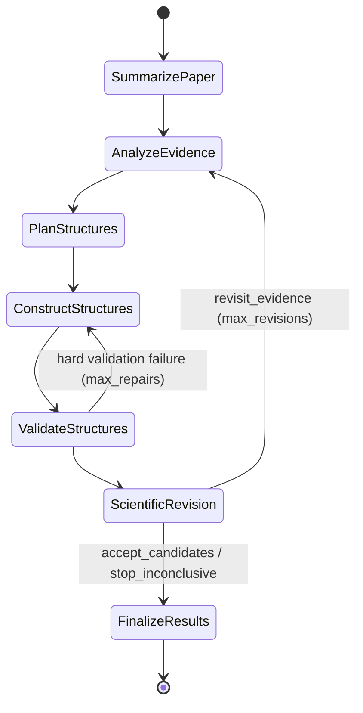

# Paper2Structure

Multi-agent workflow (PydanticAI + pydantic-graph) that turns an experimental materials paper into
simulation-ready atomic structures (POSCAR, optionally CIF/extxyz) for MLIP-based simulations.
Every structure comes with the standalone Python script that generated it.

**Current slice.**
- **Implemented:** the Planner (Agent 3), the Construction agent (Agent 4, a
  [pydantic-ai-harness](https://pydantic.dev/docs/ai/harness/) coding agent), deterministic structure
  validation and a minimal Scientific Revision agent (Agent 5).
- **Placeholders:** Agents 1-2 (paper summary, experimental evidence) load the input files named in
  the config.
- **Inputs used so far:** the scenarios in `examples/fixtures/`, which are hand-written synthetic
  inputs, not extracted from real papers.

## Workflow



| node | agent | does |
|---|---|---|
| SummarizePaper | Agent 1 (placeholder) | loads `inputs.paper_summary`; runs once |
| AnalyzeEvidence | Agent 2 (placeholder) | loads `inputs.experimental_evidence`; re-entered when the reviewer finds that the structures do not resemble the paper |
| PlanStructures | Agent 3, `LLMPlanner` | competing structural hypotheses as `StructurePlan`s: a free-form model type and construction brief, named crystals (space group + Wyckoff positions + lattice with provenance), optional surface/nanocrystal/adsorbate/solvent specs, measurable targets, evidence IDs, assumptions |
| ConstructStructures | Agent 4, `LLMConstructor` | a Coder agent writes and runs its own Python in a sandboxed workspace; every reported structure is rebuilt by running its script alone from scratch and must pass the validation gate |
| ValidateStructures | deterministic | the same gate checks plus the export round trip; hard failures go back to construction |
| ScientificRevision | Agent 5, `LLMReviser` | accept / stop / revisit evidence (Agent 2 -> 3 -> 4); can read the build scripts; writes the final report (`write_report` tool) before ending the run |

The graph is built from `BaseNode` classes whose `run` return annotations are the edges
(`src/paper2structure/graph/`). Each run renders its own diagram to `workflow.mmd`.

## Package layout

```
src/paper2structure/
  config.py              campaign YAML -> Pydantic config
  agents/                one package per agent: agent.py + schemas.py
    structured_agent.py  shared base (model, retries, usage, preflight)
    summarizer/          Agent 1 (placeholder: loads inputs.paper_summary)
    characterization/    Agent 2: technique agents (XRD, NMR, ...) to come; placeholder loads
                         inputs.experimental_evidence
    planner/             Agent 3
    constructor/         Agent 4, plus workspace.py (sandbox, replay) and skills/
    reviser/             Agent 5, plus the final report (write_report tool)
  graph/                 nodes, state (incl. the run-directory store), workflow, run-level schemas
  tools/                 the structure toolkit construction scripts import, its checks and their schemas
```

## The Construction agent

Agent 4 is not limited to predefined builders. It is a pydantic-ai-harness
[`Coder`](https://pydantic.dev/docs/ai/harness/coder/) (file tools, shell, tool-output limits,
context clearing, argument repair, prompt caching). It writes any Python with ASE, pymatgen, RDKit,
numpy and scipy, so it can build core-shell particles, interfaces, defects or supported particles.
`paper2structure.tools` is an optional helper library for the steps that are easy to get subtly
wrong.

| harness / workflow piece | role here |
|---|---|
| `Coder` | `read_file`, `write_file`, `edit_file`, `list_files`, `grep`, `shell` in the attempt's workspace |
| `BubblewrapSandbox` (`BubblewrapWorkspace`) | every command runs with the host read-only, no network, only the workspace writable; `construction.hide_paths` (`.env`, `~/.ssh`, ...) unreadable; no API keys in the environment |
| `Skills` | `agents/constructor/skills/`, copied to `.agents/skills/` in each workspace and loaded on demand: `structure-toolkit` (API reference generated from the docstrings), `surfaces-and-adsorbates`, `nanocrystals` (incl. core-shell, supported particles), `custom-structures` (defects, interfaces, 2D, mixtures), `solvation` |
| `Planning` | the agent's own task list across plans |
| `SystemReminders` | re-states the script contract every `reminder_every` requests |
| `Memory` (optional) | a notebook kept across runs in `construction.memory_dir` |
| `check_structure`, `view_structure` | workflow tools: deterministic validation + `describe()` (incl. layer / radial composition), rendered views |
| output validator | each reported script is copied alone into an empty directory and re-run in the sandbox; it must reproduce its structures exactly, and the replayed structures must pass the validation gate, else the agent fixes it |

### Validation gate

Every structure the agent reports passes deterministic checks before the report is accepted. These
are the checks `check_structure` shows the agent while it works:

| check | fails when |
|---|---|
| overlaps | two atoms closer than 0.6 x their covalent-radius sum |
| molecule integrity | a molecule's bond graph differs from its SMILES |
| adsorbate binding | an adsorbate's closest substrate contact is beyond 2.0 x the covalent sum (detached; 1.5-2.0 x warns), or an electronegative donor on an ionic surface touches an anion instead of a cation |
| charge neutrality (off by default: `validation.charge_neutrality`) | substrate formal charges (the plan's oxidation states, `carve_nanocrystal`'s, or common ones; mixed valence allowed between consecutive states) plus the SMILES charges do not sum to zero |
| vacuum, atom budget | less than `validation.min_vacuum` between images; more than `planning.max_atoms` atoms |

The checks share one neighbor list, so a 3000-atom particle with 80 adsorbates validates in about
0.5 s. Failures go back to the agent in the same conversation, at most `construction.gate_retries`
times. After that the report passes on to ValidateStructures, the repair loop and the reviewer, so
the gate never stalls a run.

The script contract: one standalone file per plan; named parameters and `SEED` at the top;
positions from code (symmetry, geometry, searches), never typed from memory; molecules registered
via `place_adsorbates`, `add_solvent` or `add_molecule` so validation can check them; each finished
structure registered with `emit()`.

The reviewer (Agent 5) gets a read-only harness workspace over `structures/`, with
`read_file`/`list_files`/`grep` on the scripts (`revision.read_scripts`).

## Setup

```bash
conda activate /net/csefiles/coc-fung-cluster/Jun/conda_envs/paper2structure
conda install -c conda-forge bubblewrap   # the sandbox (bwrap); needs unprivileged user namespaces
pip install -e . --extra-index-url https://download.pytorch.org/whl/cu126
```

Torch and Warp are pinned to **CUDA 12 builds** (`torch==2.14.1+cu126`, `warp-lang 1.18.0+cu12`),
because the cluster driver (550.x) supports CUDA <= 12.4 and the default CUDA 13 wheels cannot use
the GPUs. Large neighbor searches use NVIDIA ALCHEMI Toolkit-Ops on the GPU when one is visible,
and ASE otherwise. `pydantic-ai` and `pydantic-ai-harness[coder]` are pinned (the harness is 0.x).

The API key is read from `.env` (`export OPENAI_API_KEY=...`):

```bash
set -a; source .env; set +a
```

## Run

```bash
python run_construction.py --config config/cdse_zns_coreshell.yml --output_dir runs/cdse_zns --random_seed 0 --gpu 0
```

| flag | meaning |
|---|---|
| `--config` | campaign YAML (see below) |
| `--output_dir` | run directory |
| `--random_seed` | the `SEED` the build scripts use (conformers, placement, packing) (required) |
| `--max_revisions` | loops the reviewer may take back through evidence -> planning -> construction (default 1) |
| `--max_repairs` | construction retries after hard validation failures (default 2) |
| `--gpu` | GPU index for neighbor lists in the workflow and in the sandboxed scripts (sets `CUDA_VISIBLE_DEVICES`, `construction.gpu`) |
| `--skip_preflight` | skip the per-agent connectivity checks |

## Configuration

Campaign-specific settings live in a YAML file loaded by `src/paper2structure/config.py`, which
validates them as Pydantic models and rejects unknown keys (`config/config.yml` documents every
field). Run-level settings are CLI flags; both are snapshotted to `<output_dir>/config.json`.

| section | holds |
|---|---|
| `campaign` | LLM (`gpt-5.6-luna`, default reasoning effort), output-validation retries, whether agents see rendered structures |
| `inputs` | Agent 1-2 outputs (paper summary, evidence snapshot) |
| `planning` | max plans, max atoms per structure (default 5000) |
| `construction` | sandbox (`bubblewrap`/`none`), network, gpu, hidden paths, request and tool-call budget, replay timeout/memory, Planning, reminders, delegation, Memory |
| `validation` | overlap / close-contact / bond / adsorbate-binding scale factors, minimum vacuum |
| `revision` | whether the reviewer may read the build scripts |
| `export` | output formats, default `[poscar]` |
| `overrides` | user-pinned choices the planner must respect (model type, Miller index, supercell, lattice) |

`construction.gpu`: CUDA cannot start under the harness's network-off seccomp socket filter, so a
GPU sandbox keeps the network off with an empty network namespace instead and binds `/dev/nvidia*`.
Without it, sandboxed scripts compute neighbor lists on the CPU.

## Outputs (`<output_dir>/`)

| path | content |
|---|---|
| `structures/<id>.py` | **the standalone script that generated `<id>`**, verified by a from-scratch re-run; `python <id>.py` rebuilds it into `structures/` of the current directory |
| `structures/<id>.vasp` | POSCAR (species grouped, fixed atoms as selective dynamics); `.cif`/`.extxyz` if configured |
| `structures/<id>.json`, `.png` | per-atom roles (tags 0/1 substrate, 2 adsorbate, 3 solvent), molecule ids and records; top/side views |
| `structures/README.md` | which script rebuilds which structure |
| `final_report.md` | the reviewer's summary, assessment and next steps around the generated record: evidence used, hypotheses, structures with how they were built and the measured targets, validation, revision decisions, how to reproduce, limitations |
| `construction/r<rev>_a<attempt>/workspace/` | the agent's workspace: `task/` (plans, context, feedback), every script it wrote, `structures/` (emitted), `.agents/skills/`, `README.md` |
| `construction/r<rev>_a<attempt>/replay/<script>/` | the from-scratch re-run of each final script |
| `plans.json`, `artifacts.json`, `validation_reports.json`, `revision_history.json`, `construction_reports.json` | full history; nothing is overwritten across revisions |
| `state/NN_<node>.json` | graph-state snapshot after every node |
| `result.json`, `token_log.json`, `config.json`, `workflow.mmd`, `run.log` | run summary, LLM usage, config snapshot, graph, log |

## Helper library (`paper2structure.tools`)

- `build_bulk`: space group, Wyckoff positions and lattice -> conventional cell. It checks overlaps,
  formula units and that every atom has a bonded neighbour; the last catches species on the wrong
  sites, such as a perovskite with A and B swapped. The planner's output validator builds every
  planned crystal this way, so bad crystals go back to the planner before construction.
- `list_terminations`, `build_slab`: pymatgen terminations (both faces of asymmetric cuts) with the
  exposed atoms and their coordination; primitive surface cell, supercell, vacuum, fixed bottom.
- `build_cluster`, `carve_nanocrystal`: closed-shell metal clusters; faceted or spherical particles cut
  from any crystal, with dangling-atom pruning and charge balancing.
- `Adsorbate`, `BindingMotif`: RDKit molecule with binding atoms from an anchor SMARTS.
- `surface_sites`, `place_adsorbates`: top/bridge/hollow sites; coarse-to-fine rotational placement in
  "adsorb" or "replace" mode. Replace mode honours a target donor-neighbour bond length.
  Monatomic adsorbates (e.g. `[H+]`) work like any adsorbate. Adsorbate logic is ported from
  [PerovKit](https://github.com/sj-cha/PerovKit) and generalized beyond perovskites.
- `add_molecule`: registers a molecule positioned by custom code (tags, molecule id, SMILES record).
- `add_solvent`: random-insertion solvent packing (slab layer or around a particle).
- `describe`, `composition_profile`, `structure_kind`, `vacuum_gap`: summaries that also work on
  custom structures (layer composition for slabs, radial shells for particles, kind inferred from
  the vacuum).
- `emit`: registers a finished structure: `structures/<name>.extxyz`, `.vasp`, `.json`, and the
  emitting script in `structures/manifest.json`.

## Tests

```bash
pytest            # offline: tools, sandbox, replay, skills, scripted Coder agents, graph routing (no LLM calls)
pytest -m live    # end-to-end CLI run with the real LLM (needs OPENAI_API_KEY)
```

## Limitations

- Agents 1-2 are placeholders; revisiting the evidence re-reads the same snapshot and only forwards
  the reviewer's feedback to the planner.
- Structures are unrelaxed starting geometries; no MLIP/DFT relaxation and no simulated observables
  (XPS, IR, XRD). Agreement with experiment is judged qualitatively, and an accepted structure is a
  plausible starting point, not an experimentally established one.
- Lattice positions supplied by the planner from the literature are assumptions and are recorded
  as such.
- The sandbox keeps the agent from changing the host outside its workspace and from the network;
  it is not a boundary against deliberate attacks (commands can read files the user can read,
  except the hidden paths). Use a dedicated user or a cloud sandbox for untrusted inputs.
- Only ordered models; disorder is represented by ordered representatives.
