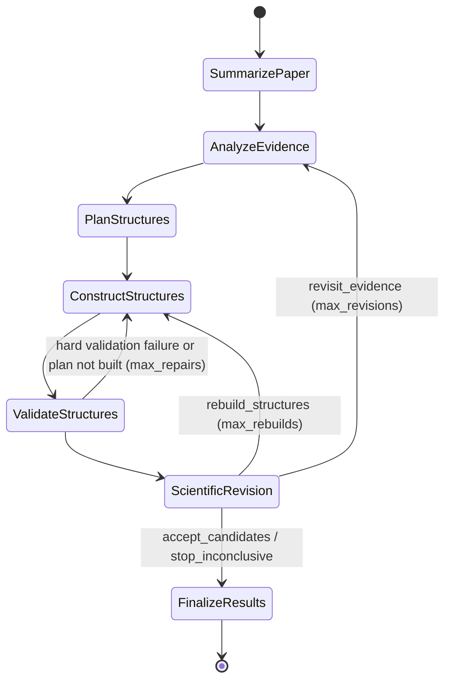

# Paper2Structure

Multi-agent workflow (PydanticAI + pydantic-graph) that turns an experimental materials paper (PDF)
into simulation-ready atomic structures (POSCAR, optionally CIF/extxyz) for MLIP-based simulations.
Every structure comes with the standalone Python script that generated it.

**Current slice.**
- **Implemented:** all five agents in one graph run: the summarizer (Agent 1) reads the PDF into a
  knowledge graph of material systems and evidence; characterization (Agent 2) runs one agent per
  technique on the figures and text; then the Planner (Agent 3), the Construction agent (Agent 4, a
  [pydantic-ai-harness](https://pydantic.dev/docs/ai/harness/) coding agent), deterministic
  structure validation and a minimal Scientific Revision agent (Agent 5).
- **Techniques:** every technique in the vocabulary (`config.TECHNIQUES`: XRD, TEM, SEM, AFM, XPS,
  XAS, Raman, FTIR, UV-Vis, NMR, Mossbauer, TGA, DFT, Structure model) has a filled-in spec.
  Techniques outside it (e.g. PL, ICP-OES, magnetization) get no characterization agent; a spec
  marked as a stub (`implemented=False`) is skipped unless `characterization.include_stubs`.
- **Inputs:** a paper PDF, or one of the scenarios in `examples/fixtures/`, which stand in for the
  output of Agents 1-2 and are hand-written synthetic inputs, not extracted from real papers.

## Workflow



| node | agent | does |
|---|---|---|
| SummarizePaper | Agent 1, summarizer | reads the PDF into a `PaperGraph` (material systems `S1`, `S2`, ...; text and figure evidence `E001`, ... tagged by technique) saved under `paper/`, or loads `inputs.paper_graph`; runs once |
| AnalyzeEvidence | Agent 2, characterization | one `CharacterizationAgent` per technique found that has a filled-in spec, concurrently; each reads its figure images and text records and returns observations, findings and structural constraints (`characterization/<TECH>.json`); or loads `inputs.characterization`. Re-entered on `revisit_evidence`: the reports are kept and the reviewer's feedback goes to the planner |
| PlanStructures | Agent 3, `LLMPlanner` | competing structural hypotheses as `StructurePlan`s: the material systems modeled (`system_ids`), a free-form model type and construction brief, named crystals (space group + Wyckoff positions + lattice with provenance, and the molecules of a hybrid or molecular crystal), optional surface/nanocrystal/adsorbate/solvent specs, the paper's claims as checks for the validation gate (below), measurable targets, evidence IDs (summarizer `E004` or technique-qualified observations `XRD:O3`; unknown IDs go back to the planner), assumptions |
| ConstructStructures | Agent 4, `LLMConstructor` | one Coder run per plan, concurrently, each in its own sandboxed workspace and request budget, writes and runs its own Python; every reported structure is rebuilt by running its script alone from scratch and must pass the validation gate; a run that fails or reports the plan as not built records the reason |
| ValidateStructures | deterministic | the same gate checks plus the export round trip; hard failures and plans not built go back to construction with the reasons and the last attempt's scripts |
| ScientificRevision | Agent 5, `LLMReviser` | accept / stop / rebuild structures (the plan stands, the build is wrong: back to construction with its feedback and the previous scripts; the structures it does not list are kept) / revisit evidence (back through AnalyzeEvidence -> planning -> construction); sees every claim check's result and runs checks of its own (`check_claim` tool); can read the build scripts; writes the final report (`write_report` tool) before ending the run |

The graph is built from `BaseNode` classes whose `run` return annotations are the edges
(`src/paper2structure/graph/`). Each run renders its own diagram to `workflow.mmd`. When an agent
fails, the run ends with status `failed` (a failed construction attempt still goes to review if
earlier structures exist), and so does a paper in which the summarizer finds no material system;
a failed technique agent is only recorded as an error.

### The summarizer (Agent 1)

`agents/summarizer/graph.py` is a pydantic-graph of its own:

| step | LLM calls | does |
|---|---|---|
| ReadPDF | none | pymupdf: page text without the text inside figures; figure regions (embedded images and clustered vector drawings, merged) cut out as PNGs, each with its closest "Fig. N" caption and the body sentences citing it |
| FindSystems | 1 | paper metadata and every distinct material system (each member of a doping series, phase or substrate is its own system) |
| ExtractTextEvidence | 1 per system | synthesis, the structure the text states (space group, lattice parameters, site occupancy, phase purity) and one evidence item per technique: values, conditions, cited figures, a verbatim quote |
| AnalyzeFigure | 1 per figure (vision) | catalogues each panel (technique, plot type, axes, systems shown) without reading values off it |
| BuildGraph | none | merges series-wide text items returned once per system, numbers the evidence, builds the knowledge graph (paper -> system -> evidence -> technique / figure) and saves it |

Technique names map onto one vocabulary (`config.TECHNIQUES`, canonical names with aliases, e.g.
HRTEM and SAED -> TEM, Rietveld -> XRD), which also keys the characterization agents. Answers
with unknown system IDs go back to the model; a system or figure that fails is logged in
`paper/errors.txt` and the rest continues.

### Characterization (Agent 2)

Each technique agent's system prompt is generated from a `TechniqueSpec`
(`agents/characterization/techniques/<tech>.py`: observables, how to read the figures, what may be
inferred, interpretation rules, limitations). The agent gets the material systems, the figure
records of its technique (caption, citing sentences, the panels to read) with the images, and the
text records. It returns a `CharacterizationReport`: observations (`O1`, ...: quantity, value, the
source figure or evidence ID, systems, and whether it is a printed label, an axis estimate, a
visual feature or stated in the text), findings, structural constraints (value, derivation, cited
observations, confidence) and caveats. Agents 3-5 see the reports as `ExperimentalEvidence`, with
the skipped techniques and why (a stub spec, or a technique outside the vocabulary).

## Package layout

```
main.py                  the CLI: one graph run, PDF -> structures
app/                     the web tool: server.py (Starlette app + JSON API), projects.py (project store, the three
                         stages, job runner), static/ (the page, 3Dmol.js viewers), structure_info.py (size, compute estimate)
config/                  config.yml (every field documented) and the fixture campaigns
src/paper2structure/
  config.py              campaign YAML -> Pydantic config; get_model(); the technique vocabulary
  agents/                one package per agent
    structured_agent.py  shared base of Agents 3-5 (model, retries, usage, preflight)
    summarizer/          Agent 1: graph.py (the steps), pdf_reader.py (text and figures), agents.py
                         (the three LLM agents), knowledge_graph.py (graph, saved files, load_graph),
                         schemas.py (PaperGraph), cli.py (standalone run), dry_run.py
    characterization/    Agent 2: agent.py (CharacterizationAgent), spec.py (TechniqueSpec -> prompt),
                         techniques/ (one spec per technique), schemas.py (CharacterizationReport,
                         ExperimentalEvidence), dry_run.py
    planner/             Agent 3: agent.py + schemas.py
    constructor/         Agent 4, plus workspace.py (sandbox, replay) and skills/
    reviser/             Agent 5, plus the final report (write_report tool)
  graph/                 nodes, state (incl. the run-directory store), workflow, run-level schemas
  tools/                 the structure toolkit construction scripts import, its checks and their schemas
examples/fixtures/       synthetic scenario inputs (see its README)
```

`dry_run.py` registers canned answers for the `dry-run` model (see Configuration).

## The Construction agent

Agent 4 is not limited to predefined builders. It is a pydantic-ai-harness
[`Coder`](https://pydantic.dev/docs/ai/harness/coder/) (file tools, shell, tool-output limits,
context clearing, argument repair, prompt caching). It writes any Python with ASE, pymatgen, RDKit,
numpy and scipy, so it can build core-shell particles, interfaces, defects or supported particles.
`paper2structure.tools` is an optional helper library for the steps that are easy to get subtly
wrong.

| harness / workflow piece | role here |
|---|---|
| `Coder` | `read_file`, `write_file`, `edit_file`, `list_files`, `grep`, `shell` in the attempt's workspace |
| `BubblewrapSandbox` (`BubblewrapWorkspace`) | every command runs with the host read-only, no network, only the workspace writable; `construction.hide_paths` (`.env`, `~/.ssh`, ...) unreadable; no API keys in the environment |
| `Skills` | `agents/constructor/skills/`, copied to `.agents/skills/` in each workspace and loaded on demand: `structure-toolkit` (API reference generated from the docstrings), `surfaces-and-adsorbates`, `nanocrystals` (incl. core-shell, supported particles), `custom-structures` (defects, interfaces, 2D, mixtures), `solvation` |
| `Planning` | the agent's own task list across plans |
| `SystemReminders` | re-states the script contract every `reminder_every` requests |
| `Memory` (optional) | a notebook kept across runs in `construction.memory_dir` |
| `check_structure`, `view_structure` | workflow tools: deterministic validation + `describe()` (incl. layer / radial composition), rendered views |
| output validator | each reported script is copied alone into an empty directory and re-run in the sandbox; it must reproduce its structures exactly, and the replayed structures must pass the validation gate, else the agent fixes it |

### Validation gate

Every structure the agent reports passes deterministic checks before the report is accepted. These
are the checks `check_structure` shows the agent while it works:

| check | fails when |
|---|---|
| overlaps | two atoms closer than 0.6 x their covalent-radius sum |
| molecule integrity | a molecule's bond graph differs from its SMILES |
| molecule geometry | a molecule is not an RDKit conformer of its SMILES: a bond length more than 0.12 A or a bond angle more than 20 degrees off both the UFF and the MMFF conformer (RDKit's own spread over seeds and methods is 0.09 A and 15 degrees; torsions are free) |
| unregistered molecules | C-H or N-H bonds in substrate fragments that no heavy atom bonds to a metal: organic molecules not registered with `place_adsorbates`, `add_solvent`, `add_molecule` or `fill_cavities` (organic parts bonded into the framework, such as MOF linkers, belong to it) |
| isolated atoms | a substrate atom has no neighbour within 1.5 x the covalent sum (placeholder atoms) |
| adsorbate binding | an adsorbate's closest substrate contact is beyond 2.0 x the covalent sum (detached; 1.5-2.0 x warns), or an electronegative donor on an ionic surface touches an anion instead of a cation |
| charge neutrality (off by default: `validation.charge_neutrality`) | substrate formal charges (the plan's oxidation states, `carve_nanocrystal`'s, or common ones; mixed valence allowed between consecutive states) plus the SMILES charges do not sum to zero |
| vacuum, atom budget | less than `validation.min_vacuum` between images; more than `planning.max_atoms` atoms |
| like-charge contacts (ionic substrates) | two cations (metal atoms of the substrate or of different molecules) or two substrate anions closer than 0.7 x the covalent sum (0.7-0.8 warns) |
| bond valence (ionic substrates) | the bond-valence sum of a framework cation at interior sites is off its oxidation state by more than 40% (30-40% warns), or one bond carries more than all of its cation's valence (more than 45% warns) |
| claims (the plan's checks) | the structure contradicts a claim of the paper (below) |

**The paper's claims as checks.** The structural claims of a run get IDs: the facts the summarizer
recorded for each system (`S2:space_group`, `S2:lattice`, `S2:other1`, ...) and the structural
constraints of the characterization reports (`XRD:C3`, ...). Every plan turns each claim about its
systems into typed checks, or lists it under `unchecked` with the reason; the planner's output is
sent back until every claim is covered. The check types are fixed and evaluated by code
(`tools/evidence_checks.py`), the planner sets their values, tolerances, scope and systems:

| check | passes when |
|---|---|
| lattice (bulk) | each cell length is the target (or an integer multiple, for supercells) within the relative tolerance, angles within 1 degree |
| space_group (bulk) | spglib finds the reported group (any ITA setting, e.g. `Cc2m`, `C2cb`) at `symprec`; `scope: framework` leaves the molecules out, for experiments that average over disordered molecules |
| composition (bulk) | the atomic fractions match the formula |
| bond_length, bond_angle | every first-shell A-B distance, or A-B-C angle at vertex B, lies in the reported range |
| coordination | every interior framework atom of the element has the reported number of neighbours |
| hydrogen_bonds | every donor atom of the molecules (e.g. the N of an NH3+ group) has the reported number of H pointing at acceptors (H...A below the van der Waals sum, D-H...A at least 130 degrees) |
| layers | each connected framework block holds the reported number of planes of the element along the stacking axis (a block bonded to its own periodic image is not a layer) |

A failing check of severity `fail` sends the structure back to construction like any gate failure;
`warn` is for approximate claims; checks of bulk properties are `skip` on slabs and particles.
The final report tabulates every check on every structure, and the reviewer can run further
checks with `check_claim`.

**Crystals with molecules** (organic cations in layered or 3D frameworks, templates in zeolites,
intercalated or guest molecules, molecular salts) are crystals in the plan: Wyckoff sites for the
framework and a list of molecules per cell. The construction script builds the framework with
`build_bulk` and adds each molecule with `fill_cavities`, which puts its charged or binding atom
at van der Waals contact with the most framework atoms of opposite character, turns it so the
most N-H/O-H donors point at acceptors, and adds its images under the space group, so the
crystal keeps the framework's symmetry.

The bond-valence check uses pymatgen's generic bond-valence parameters, so it applies to any
ionic material without per-material tables. It looks at the framework cations, the ones with the
strongest bonds (valence / coordination, e.g. Pb in a lead halide, Ti in a titanate, Ru in a
ruthenate), at interior sites, at least 4 A below a slab's or particle's surface, with at least
three anion neighbours. Oxidation states come from the plan, `carve_nanocrystal` or
charge-balanced common states (molecule charges included). Large cations in big cages (Cs, Sr, Ba
or Bi on perovskite A sites) are under-bonded with generic parameters and are left out. Calibrated
on 22 known-good crystals and every structure of the PDF runs, it fails the compressed, stretched
and mis-coordinated frameworks those runs produced, and passes every correct one; one known-good
reference, CsCl, warns. Organic atoms left in the substrate (not registered with `add_molecule`)
make it warn instead of assessing. The thresholds are in `validation` (`bvs_warn`, `bvs_fail`,
`bond_share_warn`, `like_contact_warn`, `like_contact_fail`).

The checks share one neighbor list, so a 3000-atom particle with 80 adsorbates validates in about
0.5 s. Failures go back to the agent in the same conversation, at most `construction.gate_retries`
times. After that the report passes on to ValidateStructures, the repair loop and the reviewer, so
the gate never stalls a run.

The script contract: one standalone file per plan; named parameters and `SEED` at the top;
positions from code (symmetry, geometry, searches), never typed from memory; every molecule an
RDKit conformer (`Adsorbate.from_smiles`) moved rigidly or with torsions turned, registered via
`place_adsorbates`, `add_solvent` or `add_molecule` (which rejects hand-built geometry) so validation
can check it; each finished structure registered with `emit()`.

The reviewer (Agent 5) gets a read-only harness workspace over `structures/`, with
`read_file`/`list_files`/`grep` on the scripts (`revision.read_scripts`).

## Setup

```bash
conda create -n paper2structure python=3.12 && conda activate paper2structure   # any Python >= 3.12 env
conda install -c conda-forge bubblewrap   # the sandbox (bwrap); needs unprivileged user namespaces
pip install -e . --extra-index-url https://download.pytorch.org/whl/cu126   # ".[app]" adds the web tool's server, ".[test]" pytest
```

Torch and Warp are pinned to **CUDA 12 builds** (`torch==2.10.0` from the cu126 index above,
`warp-lang 1.18.0+cu12`), because the cluster driver (550.x) supports CUDA <= 12.4 and CUDA 13
wheels cannot use the GPUs. Large neighbor searches use NVIDIA ALCHEMI Toolkit-Ops on the GPU when
one is visible, and ASE otherwise. `pydantic-ai` and `pydantic-ai-harness[coder]` are pinned (the
harness is 0.x). The summarizer reads PDFs with pymupdf.

The API key goes in `.env` in the repo root (git-ignored):

```
OPENAI_API_KEY=sk-...
P2S_MODEL=openai:gpt-5.6-luna   # optional: the model when campaign.model is null
```

`paper2structure.config` loads it with python-dotenv, so `main.py`, the summarizer CLI and the web
page need no `source .env`; an exported `OPENAI_API_KEY` works as well and takes precedence.

## Run

```bash
python main.py --pdf pdf/<paper>.pdf --random_seed 0                      # -> runs/<paper>/
python main.py --pdf pdf/<paper>.pdf --random_seed 0 --output_dir runs/x --techniques XRD TEM --gpu 0
python main.py --paper_graph runs/x/paper/paper_graph.json --characterization runs/x/characterization \
    --output_dir runs/x_replan --random_seed 0                            # reuse Agents 1-2 of run x
python main.py --config config/cdse_zns_coreshell.yml --random_seed 0     # synthetic fixture campaign
```

Settings come from the campaign YAML (`--config`); the
flags set the run-level values and override the YAML where they overlap.

| flag | meaning |
|---|---|
| `--pdf` | the paper (sets `inputs.pdf`) |
| `--paper_graph` | `paper_graph.json` of an earlier run: skips the summarizer (sets `inputs.paper_graph`) |
| `--characterization` | folder of saved characterization reports, e.g. an earlier run's `characterization/`: skips Agent 2 |
| `--config` | campaign YAML (default `config/config.yml`; see below) |
| `--output_dir` | run directory (default `runs/<pdf name>`; with `--paper_graph runs/x/paper/paper_graph.json`, `runs/x_replan`) |
| `--random_seed` | the `SEED` the build scripts use (conformers, placement, packing) (required) |
| `--model` | every agent's model, e.g. `openai:gpt-5.6-luna` (sets `campaign.model`) |
| `--techniques` | characterize only these, e.g. `XRD TEM` (aliases work); default: every technique found |
| `--include_stubs` | also run the technique agents whose spec is a stub (none at present) |
| `--no_figures` | the summarizer skips figure cataloguing, so Agent 2 reads only the text |
| `--max_figures` | max figure regions cut from the PDF (default 30) |
| `--max_revisions` | loops the reviewer may take back through evidence -> planning -> construction (default 1) |
| `--max_rebuilds` | rounds the reviewer may send structures back to construction under the same plans (default 2) |
| `--max_repairs` | construction retries after hard validation failures or unbuilt plans, per construction request (default 2) |
| `--gpu` | GPU index for neighbor lists in the workflow and in the sandboxed scripts (sets `CUDA_VISIBLE_DEVICES`, `construction.gpu`) |
| `--skip_preflight` | skip the connectivity checks of Agents 3-5 |

The summarizer also runs alone (Agent 1 only, written to `outputs/<pdf name>/` by default):

```bash
python -m paper2structure.agents.summarizer.cli pdf/<paper>.pdf [--out DIR] [--model dry-run] [--no-figures]
paper-summarizer pdf/<paper>.pdf    # the same, installed as a script
paper-summarizer --show-graph       # its workflow as a Mermaid diagram
```

### The web tool

`app/server.py` (the `app` extra) is the same workflow as a three-panel page for people who do not
want to touch the CLI or the YAML. Everything it makes is kept under `outputs/projects/<paper>_<time>/`,
so a paper can be reopened later and each step is reused rather than repeated:

```bash
python app/server.py            # then open http://127.0.0.1:8600
```

| panel | does | runs | reused when |
|---|---|---|---|
| 1 Paper & model | upload the PDF; pick the model (with its price per 1M tokens) and the reasoning effort; open an earlier paper | Agent 1 -> `paper/` | always (re-read on request) |
| 2 Summary & system | the paper's systems, evidence by technique with the figure crops; tick the material system(s) to model, the techniques to analyze and the number of hypotheses | Agent 2 -> `characterization/<key>/`, then Agent 3 on the chosen systems -> `plans/<key>.json` | Agent 2 per model + technique set; Agent 3 per settings |
| 3 Structures | DFT or MD, a "computationally tractable <-> closer to experiment" slider that sets the atom budget and the planner's brief, structure type, seed, reviewer loops; the built structures in 3Dmol.js with size, compute estimate, target checks, downloads and the reviewer's report | Agents 3-5 as one graph run -> `runs/<time>/` (the plan of panel 2 is handed to the graph; the planner only runs again when the settings changed) | every run is kept; pick earlier runs from the list |

Panel 2 gives the planner only the systems the user ticked (a copy of the summary restricted to them,
`runs/<time>/inputs/paper_graph.json`), so the plans cannot drift to the other samples of a series.
Jobs run one at a time on a worker thread and the page polls their log; the API key comes from `.env`
or can be pasted on panel 1 for the server session. Without bubblewrap (macOS) construction runs
with `sandbox: none`, as the CLI does.

## Configuration

Campaign-specific settings live in a YAML file loaded by `src/paper2structure/config.py`, which
validates them as Pydantic models and rejects unknown keys (`config/config.yml` documents every
field). Run-level settings are CLI flags; both are snapshotted to `<output_dir>/config.json`.

| section | holds |
|---|---|
| `campaign` | every agent's model as a pydantic-ai name (`openai:gpt-5.6-luna`, the OpenAI Responses API; null = `$P2S_MODEL` or that default; `dry-run` returns canned answers and works for Agents 1-2 only), reasoning effort of Agents 3-5 (null = provider default), output-validation retries, whether agents see rendered structures |
| `inputs` | the paper: `pdf`, or `paper_graph` (an earlier run's `paper/paper_graph.json`, skips Agent 1); `characterization` (a folder of saved reports, skips Agent 2); paths relative to the working directory or the config's folder |
| `summarizer` | `analyze_figures` (one vision call per figure), `max_figures` (default 30) |
| `characterization` | `techniques` (null = every technique found), `include_stubs`, `reasoning_effort` (default high), `output_retries` |
| `planning` | max plans, max atoms per structure (default 5000) |
| `construction` | sandbox (`bubblewrap`/`none`), network, gpu, hidden paths, request and tool-call budget, replay timeout/memory, Planning, reminders, delegation, Memory |
| `validation` | overlap / close-contact / bond / adsorbate-binding scale factors, minimum vacuum, bond-valence and like-charge thresholds |
| `revision` | whether the reviewer may read the build scripts |
| `export` | output formats, default `[poscar]` |
| `overrides` | user-pinned choices the planner must respect (model type, Miller index, supercell, lattice) |

`construction.gpu`: CUDA cannot start under the harness's network-off seccomp socket filter, so a
GPU sandbox keeps the network off with an empty network namespace instead and binds `/dev/nvidia*`.
Without it, sandboxed scripts compute neighbor lists on the CPU.

## Outputs (`<output_dir>/`)

| path | content |
|---|---|
| `paper/` | Agent 1, for PDF runs: `paper_graph.json` (systems, evidence and the knowledge graph), `summary.md`, `graph.dot`, `figures/p<page>_f<n>.png`, `evidence_by_technique/<TECH>.json`, `errors.txt` if a step failed |
| `characterization/<TECH>.json` | Agent 2: one `CharacterizationReport` per technique analyzed |
| `inputs/experimental_evidence_v<n>.json` | the reports as Agents 3-5 saw them, with the skipped techniques and errors |
| `structures/<id>.py` | **the standalone script that generated `<id>`**, verified by a from-scratch re-run; `python <id>.py` rebuilds it into `structures/` of the current directory |
| `structures/<id>.vasp` | POSCAR (species grouped, fixed atoms as selective dynamics); `.cif`/`.extxyz` if configured |
| `structures/<id>.json`, `.png` | per-atom roles (tags 0/1 substrate, 2 adsorbate, 3 solvent), molecule ids and records; top/side views |
| `structures/README.md` | which script rebuilds which structure |
| `final_report.md` | the reviewer's summary, assessment and next steps around the generated record: paper and material systems, structural constraints per technique, hypotheses, structures with how they were built and the measured targets, validation, revision decisions, how to reproduce, limitations |
| `construction/r<rev>_a<attempt>/<plan>/workspace/` | the agent's workspace: `task/` (plans, context, feedback), every script it wrote, `structures/` (emitted), `.agents/skills/`, `README.md` |
| `construction/r<rev>_a<attempt>/replay/<script>/` | the from-scratch re-run of each final script |
| `plans.json`, `artifacts.json`, `validation_reports.json`, `revision_history.json`, `construction_reports.json` | full history; nothing is overwritten across revisions |
| `state/NN_<node>.json` | graph-state snapshot after every node |
| `result.json`, `token_log.json`, `config.json`, `workflow.mmd` | run summary, LLM usage of Agents 3-5 (Agent 1 logs its token count in its last progress line; Agent 2's usage is not recorded), config snapshot, graph (the log goes to the console; redirect it to keep it) |

## Helper library (`paper2structure.tools`)

- `build_bulk`: space group, Wyckoff positions and lattice -> conventional cell. It checks overlaps,
  formula units and that every atom has a bonded neighbour; the last catches species on the wrong
  sites, such as a perovskite with A and B swapped. The planner's output validator builds every
  planned crystal this way, so bad crystals go back to the planner before construction.
- `list_terminations`, `build_slab`: pymatgen terminations (both faces of asymmetric cuts) with the
  exposed atoms and their coordination; primitive surface cell, supercell, vacuum, fixed bottom.
- `build_cluster`, `carve_nanocrystal`: closed-shell metal clusters; faceted or spherical particles cut
  from any crystal, with dangling-atom pruning and charge balancing.
- `Adsorbate`, `BindingMotif`: RDKit molecule with binding atoms from an anchor SMARTS.
- `surface_sites`, `place_adsorbates`: top/bridge/hollow sites; coarse-to-fine rotational placement in
  "adsorb" or "replace" mode. Replace mode honours a target donor-neighbour bond length.
  Monatomic adsorbates (e.g. `[H+]`) work like any adsorbate. Adsorbate logic is ported from
  [PerovKit](https://github.com/sj-cha/PerovKit) and generalized beyond perovskites.
- `add_molecule`: registers a molecule positioned by custom code (tags, molecule id, SMILES record).
- `add_solvent`: random-insertion solvent packing (slab layer or around a particle).
- `describe`, `composition_profile`, `structure_kind`, `vacuum_gap`: summaries that also work on
  custom structures (layer composition for slabs, radial shells for particles, kind inferred from
  the vacuum).
- `emit`: registers a finished structure: `structures/<name>.extxyz`, `.vasp`, `.json`, and the
  emitting script in `structures/manifest.json`.

## Tests

```bash
pytest            # offline: tools, sandbox, replay, skills, scripted agents, graph routing, the pipeline (no LLM calls)
pytest -m live    # end-to-end CLI run with the real LLM (needs OPENAI_API_KEY)
```

`tests/test_pipeline.py` runs the whole graph offline, from a one-page PDF it generates through
construction: the `dry-run` model answers for Agents 1-2 and scripted models for Agents 3-5. It
also covers the technique selection, reusing a saved summary and reports, and the planner's ID
checks.

## Limitations

- Agent 1 sends the full paper text once per material system (and once to find the systems) and
  one image per figure, so its cost grows with both (`--no_figures`, `summarizer.max_figures`).
- Characterization runs once per run: on `revisit_evidence` the reports are kept, not re-analyzed,
  and only the reviewer's feedback reaches the planner.
- Techniques outside the vocabulary (e.g. PL, ICP-OES, magnetization) have no characterization
  agent; they reach the planner only through the summarizer's evidence items.
- Structures are unrelaxed starting geometries; no MLIP/DFT relaxation and no simulated observables
  (XPS, IR, XRD). Agreement with experiment is judged qualitatively, and an accepted structure is a
  plausible starting point, not an experimentally established one.
- Lattice positions supplied by the planner from the literature are assumptions and are recorded
  as such.
- The sandbox keeps the agent from changing the host outside its workspace and from the network;
  it is not a boundary against deliberate attacks (commands can read files the user can read,
  except the hidden paths). Use a dedicated user or a cloud sandbox for untrusted inputs.
- Only ordered models; disorder is represented by ordered representatives.
