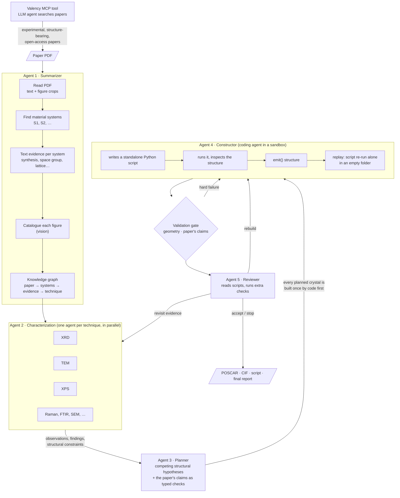
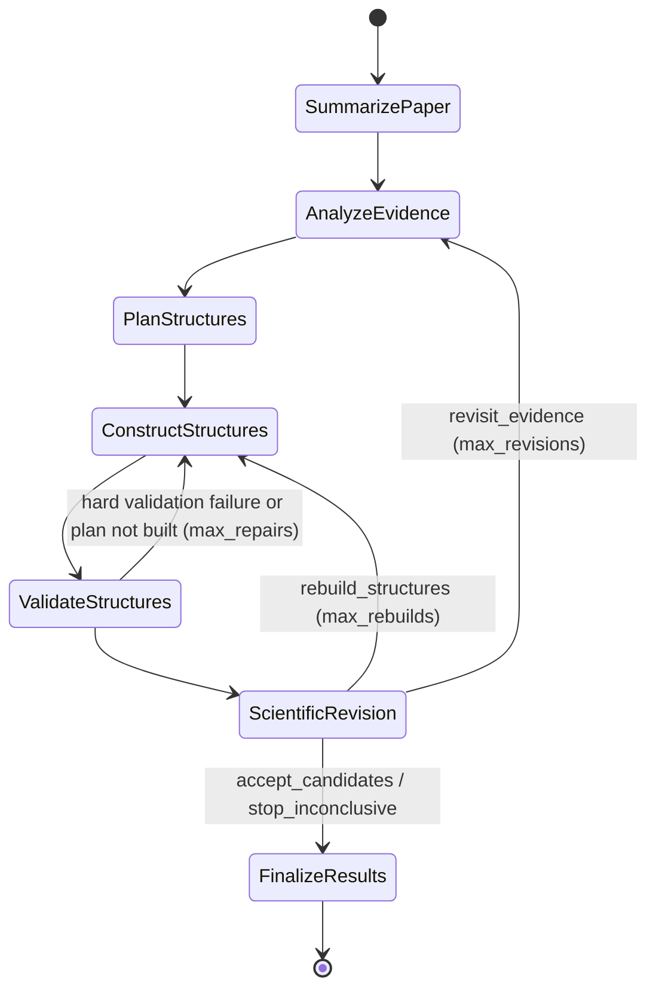

# Paper2Structure

**From an experimental materials paper (PDF) to validated, reproducible atomic structures that are ready to simulate.**

Paper2Structure is a multi-agent workflow (PydanticAI + pydantic-graph). It reads a paper the way a
materials scientist would: what was made, what each measurement shows, and what that implies about
the atomic structure. It then writes and runs the code that builds that structure and checks the
result against the paper's own claims. Every structure comes
with the standalone Python script that generated it, so anyone can rebuild it, inspect it or change it.

```
Valency search ──► paper.pdf ──►  what was made  ──►  what the data says  ──►  structural hypotheses  ──►  code that builds them
                                                                                              │
     POSCAR / CIF + script + report  ◄──  reviewer  ◄──  checks: geometry, the paper's claims   
```

**Contents:** [Motivation](#motivation) · [The problem](#the-problem-it-solves) ·
[How it works](#how-it-works) · [Theory and concepts](#theory-and-concepts) ·
[Finding papers with Valency](#finding-papers-with-valency) · [Novelty and innovativeness](#novelty-and-innovativeness) ·
[Impact](#impact) · [Relevance](#relevance) · [Results so far](#results-so-far) ·
[Quick start](#quick-start) · [Technical reference](#technical-reference)

---

## Motivation

Simulation has become one of the main ways materials are studied: density functional theory (DFT)
for electronic structure and energetics, and molecular dynamics (MD) with machine-learned
interatomic potentials (MLIPs) for larger systems and finite temperatures. Every simulation starts
from the same thing, **a set of atomic coordinates**, and for real, experimentally made materials
that starting point is still built by hand.

The knowledge needed to build it is scattered across a paper:

- the **composition** and the doping series in the methods section;
- the **space group and lattice parameters** from a Rietveld refinement, sometimes only in a table or a figure;
- the **particle size, facets or core–shell structure** in TEM images;
- **site occupancies, oxidation states and surface species** in XPS or FTIR spectra and in the discussion.

A researcher reads all of this, decides which model is reasonable (a bulk cell? a slab? a 3 nm
particle? how large a supercell to approximate a 30 % dopant?), finds or writes a builder script, and
checks the result by eye. This takes hours to days per material. It is rarely documented, rarely
reproducible, and the choices behind it, such as why this cell or why these sites, are usually lost.

Before any of this, someone has to *find* the right papers: experimental ones (not DFT studies or
reviews) that actually report structural information, and know how much they report: a deposited
CIF, only a space group and lattice parameters, or only local information such as EXAFS coordination
numbers. Searching by keyword returns mostly the wrong papers.

Large language models can now read papers, look at figures and write code. Used naively, they
also confidently produce structures with atoms on top of each other, wrong stoichiometry or impossible
bonding. Paper2Structure is built on the view that **an LLM should make the scientific judgement
calls, and deterministic code should check every one of them**.

## The problem it solves

| Today | With Paper2Structure |
|---|---|
| Finding usable experimental papers is slow keyword searching | Semantic search with Valency finds structure-bearing experimental papers, about 1.2 searches per accepted paper |
| Structure models are built by hand, one paper at a time | A PDF goes in; structures, the scripts that built them and a report come out |
| Modeling decisions live in someone's head | Every hypothesis, assumption and piece of evidence is written down with an ID (`E004`, `XRD:C3`) |
| A structure file arrives without its provenance | Each structure is regenerated from its own script in an empty folder before it is accepted |
| Errors (overlaps, wrong stoichiometry, impossible bonds) are found later, in a crashed or meaningless simulation | A validation gate rejects them before anyone sees them, and the agent fixes them |
| "Is this model consistent with the paper?" is judged by eye | The paper's claims (space group, lattice, composition, coordination, layers, ...) become automatic tests |
| One size fits all | The user chooses DFT or MD, an atom budget and a "computationally tractable ↔ closer to experiment" setting |

The output is meant to be **a defensible starting point for simulation**: unrelaxed, but consistent
with the paper, chemically sensible, and fully reproducible.

## How it works

### The pipeline at a glance



The whole run is **one typed graph** (pydantic-graph). Every node reads and writes a typed, JSON-serializable
state; a snapshot is saved after every step, so a run can be inspected step by step afterwards.

### Step by step, on a real paper

The example is *Structural studies on multiferroic La₁₋ₓBiₓCrO₃ perovskites* (Shahee, Kumar, Lalla, AIP Conf. Proc. 1349, 1243, 2011),
a 2-page paper with a five-member doping series and key numbers only in figures.

1. **Summarizer (Agent 1).** pymupdf extracts the page text and cuts every figure out as an image,
   with its caption and the sentences that cite it. One LLM call finds the five material systems
   (x = 0, 0.2, 0.25, 0.3, 0.35); one call per system collects what the text says (solid-state
   synthesis, Pnma, a = 5.48 Å, b = 7.76 Å, c = 5.49 Å, Bi on the La site); a vision call per figure
   catalogues its panels. Everything becomes a knowledge graph of 18 evidence items, each tagged
   with its technique and a verbatim quote.
2. **Characterization (Agent 2).** One expert agent per technique, here XRD and TEM, reads its figures
   and text with technique-specific instructions: what can be read off the axes, what may be inferred,
   what may not. It returns 27 observations (each marked as a printed label, an axis estimate or a
   statement in the text) and 10 **structural constraints** (e.g. "single orthorhombic Pnma phase for
   all x", with the observations it rests on and a confidence).
3. **Planner (Agent 3).** Proposes the structural model: a Pnma perovskite with Bi substituting La,
   one ordered supercell per composition, with lattice parameters traced back to the paper. It also
   turns each claim into a **typed check** (space group, lattice, composition, ...) that code will
   evaluate later. Its answer is rejected and sent back if it breaks a rule, for example too many
   plans, an unknown evidence ID, an uncovered claim, or a crystal that does not build.
4. **Constructor (Agent 4).** A coding agent writes a Python script using ASE, pymatgen and the
   project's structure toolkit, runs it, looks at the result (`check_structure`, rendered views) and
   iterates. When it reports a structure, the script is copied **alone into an empty folder and run
   again**; the replayed structure must be identical and must pass the gate.
5. **Validation gate.** Deterministic checks (see [Validation gate](#validation-gate)): overlaps,
   vacuum, atom budget, molecule integrity, chemical sanity of ionic frameworks, and the paper's
   claims as tests. Failures go back to the agent with the reason.
6. **Reviewer (Agent 5).** Reads the scripts and every check result, can run its own checks, and
   decides: accept, rebuild, revisit the evidence, or stop. It writes the final report.

Result in this run: five accepted structures (20–100 atoms), one per composition, in **about
4.5 minutes for about 7 US cents** of LLM usage (GPT-5.6 Luna, low reasoning effort). The
x = 0.3 and x = 0.35 members both came out as x = 1/3, the closest ordered cell under the 200-atom
budget, and the report says so.

### What you get

```
runs/<paper>_<time>/
├── paper/                    paper_graph.json, figure crops, summary.md        (Agent 1)
├── characterization/XRD.json observations, findings, structural constraints    (Agent 2)
├── plans.json                hypotheses, assumptions, claim checks              (Agent 3)
├── structures/
│   ├── <id>.vasp / .cif      the structure (POSCAR, CIF, extxyz)
│   ├── <id>.py               ← the standalone script that rebuilds it           (Agent 4)
│   └── <id>.png              top and side views
├── validation_reports.json   every check on every structure
└── final_report.md           what was built, why, how well it matches, what to do next (Agent 5)
```

## Theory and concepts

**Agents with typed contracts.** Each agent is an LLM whose output is a Pydantic model (a
`CharacterizationReport`, a `PlanSet`, a `ConstructionReport`), not free text. Output validators
check each answer against the rest of the run: IDs must exist, every claim must be covered, every
planned crystal must build. On failure the model gets the reason and tries again. This "propose,
then verify by code" loop is the core design principle.

**Tool use through MCP.** The Model Context Protocol lets an LLM agent call external services as
tools. Paper discovery uses this: the Valency MCP server gives a search agent semantic and keyword
search over the literature, and the agent chooses its own queries, reads the results and refines
its search (see [Finding papers with Valency](#finding-papers-with-valency)).

**Graph orchestration.** The workflow is a state machine (pydantic-graph) whose edges are the
return types of its nodes. Loops are explicit and budgeted: repairs after validation failures,
rebuilds requested by the reviewer, and revisions that go back to the evidence.

**Evidence and provenance.** The summarizer builds a knowledge graph
(paper → material system → evidence → technique/figure). Characterization observations record
*how* a value was obtained (printed on the figure, estimated from the axis, a visual feature,
stated in the text), so the planner can weigh a refined lattice parameter differently from a
peak position read off a plot.

**Technique knowledge as specifications.** Each of the 14 technique agents (XRD, TEM, SEM, AFM,
XPS, XAS, Raman, FTIR, UV-Vis, NMR, Mössbauer, TGA, DFT, structure models) gets its system prompt
from a `TechniqueSpec`: observables, how to read the figures, what may be inferred, interpretation
rules, limitations. For XRD this includes Bragg's law (nλ = 2d sin θ), what Rietveld refinement
establishes, and that peak broadening reflects size and strain.

**Crystallography.** Crystals are specified the way crystallographers report them: a space group
(Hermann–Mauguin symbol), Wyckoff positions and lattice parameters. `build_bulk` expands them by
symmetry (pymatgen) and checks formula units and bonding. A composition such as
La₀.₇Bi₀.₃CrO₃ cannot be represented exactly in a small periodic cell, so the planner chooses an
**ordered approximant** (a supercell with integer site counts) and records the approximation.
spglib verifies the space group of what was built.

**Surfaces, particles and molecules.** Slabs come from pymatgen's terminations with vacuum and
fixed bottom layers; nanocrystals are carved from the bulk with facets, dangling-atom pruning and
charge balancing; molecules are RDKit conformers of their SMILES, placed on sites (top, bridge,
hollow) or in cavities. Molecule geometry is checked against RDKit's own conformers.

**Reproducibility by construction.** A structure only counts if its script regenerates it from
nothing. The script contract fixes named parameters and a `SEED` at the top, positions computed
by code (symmetry, geometry, searches) rather than typed from memory, and one `emit()` per structure.

**Safety.** The coding agent's commands run in a bubblewrap sandbox: the host is read-only, there is
no network, only the workspace is writable, secrets are hidden and no API keys are in its environment.

**Cost awareness.** The DFT/MD choice and the atom budget are inputs, and every structure is shown
with an order-of-magnitude compute estimate (below).

## Finding papers with Valency

Paper2Structure needs the right input: **experimental** papers (synthesis plus structural
characterization, not DFT-only studies or reviews) that report structure at a known level of detail.
We find them with **Valency**, a paper-search tool for LLMs. Valency is an **MCP server** (Model
Context Protocol): it plugs into an LLM agent as a set of tools the agent can call by itself, so the
agent searches the literature, reads the results and decides what to do next, with no human copying
queries into a search box. Valency indexes PubMed and preprint servers (arXiv, ChemRxiv, ...) and
exposes, among others:

| MCP tool | What the agent uses it for |
|---|---|
| `semantic_search_papers` | search by meaning ("Rietveld refinement of a doped perovskite with site occupancies"), with a date filter, a result limit and abstracts included for triage |
| `search_by_abstract_batch` | several keyword (full-text-search) queries in one call; it also reaches papers without embeddings |
| `list_sources` | which databases are indexed (used as a connectivity check) |
| `get_paper_by_id`, `find_similar_papers` | look up or expand from a known paper |

**This is how we found our 30 test papers.** For each of the 10 material categories, a search agent
got a brief (what counts as experimental, the three tiers, a budget of Valency calls) and the Valency
tools, and then searched on its own. It wrote at least two semantic queries per category:
one about the material ("synthesis of doped or high-entropy perovskite oxide ABO3 with Rietveld
refinement ...") and one about the characterization ("refined atomic coordinates, Wyckoff positions
and site occupancies table", "EXAFS coordination numbers", "surface X-ray diffraction, LEED/STM").
It triaged the abstracts that Valency returned, shortlisted about six candidates, and then for each one:

1. resolves the DOI through OpenAlex and checks the title (`oa_lookup.py`);
2. downloads only legal open-access copies: the NIH PMC Open Access dataset, arXiv, ChemRxiv or the publisher's OA page (`pmc_fetch.py`, `fetch_pdf.py`);
3. extracts the text (`pdf_text.py`) and **verifies the tier in the full text and SI**, never from the abstract.

The agent logged every Valency call with its arguments, latency, number of results, how many were
relevant, and how many it rejected as computational or as reviews. That log is how we measured
Valency as a tool, below.

**The benchmark it produced.** 30 papers across 10 categories, each with one paper per difficulty
tier, which Paper2Structure is evaluated against:

| Tier | What the paper gives | What Paper2Structure must do |
|---|---|---|
| easy | a full refinement: CIF in the SI, a deposition number (ICSD/CCDC/COD), or a table of positions and occupancies | read it and build it correctly |
| medium | space group and lattice parameters, but no atomic positions | reconstruct positions from a prototype plus the composition |
| hard | only local or partial information: EXAFS coordination numbers, STEM, LEED/STM, particle size | build a plausible model from indirect evidence |

Categories: C1 perovskite oxides, C2 layered transition-metal dichalcogenides, C3 metal–organic
frameworks, C4 zeolites, C5 Li-ion cathodes, C6 intermetallics and high-entropy alloys, C7
single-atom catalysts, C8 supported metal nanoparticles, C9 solid-state electrolytes, C10
single-crystal electrode surfaces with adsorbates. The list with DOIs, licences, where the
structural evidence sits (page, table, SI) and the expected extraction difficulty is in the
benchmark manifest (`manifest.csv` of the `valency_checker` workspace, with the full call log and
per-category screening notes).

**How well Valency did** (37 of a 120-call budget):

| Measure | Value |
|---|---|
| Slots filled | **30 / 30**, all found by Valency (the OpenAlex fallback was never needed), all open access, 23 CC-BY |
| Searches per accepted paper | **1.23** |
| Latency | median 1.1 s, max 5.0 s |
| Results judged relevant from the abstract | 480 of 596 (**80.5 %**) |
| Rejected as computational / as reviews | 3.7 % / 3.2 % |
| Rank of the accepted paper | median 4; 28 of 30 within the top 13 |

What we learned: semantic search is very good at *discovery* and surfaced ideal sources such as IUCr
short reports with CIFs in the PMC SI. Keyword batch search was nearly useless for multi-word queries
(6 calls, 6 results in total), and about 3 % of records had an empty DOI field. Valency cannot see
*what is inside* a paper (a CIF, a coordinate table or only lattice parameters), which is why the
tier is always checked in the full text. At scale, the plan is Valency as the candidate generator,
followed by OpenAlex resolution, full text from PMC OA or arXiv, and automatic tier classification.

## Novelty and innovativeness

- **End to end from the paper itself.** Existing tools either extract text from papers or generate
  structures from a chemical formula. Paper2Structure goes from the PDF, figures included, to a
  structure model that is traceable to specific statements and figures of *that* paper.
- **Claims become tests.** The planner must turn every structural claim of the paper and of the
  characterization agents into a typed, code-evaluated check, or explicitly say why a claim cannot
  be checked. "Consistent with the paper" stops being a matter of opinion.
- **A coding agent instead of a fixed builder.** The constructor writes arbitrary Python, so it is not
  limited to a template library: core–shell particles, supported clusters, interfaces, defects,
  hybrid perovskites with organic cations, and adsorbates on slabs all go through the same path.
- **Reproducibility enforced, not hoped for.** A structure only counts if its script, run alone in an
  empty folder, rebuilds it exactly.
- **One knob from experiment to computation.** The same paper can yield a 20-atom DFT cell or a
  10,000-atom MD model; the "tractable ↔ realistic" setting and the atom budget are passed to the
  planner as hard constraints.
- **Technique knowledge as data.** Adding or improving a technique means editing a `TechniqueSpec`,
  not the agents.
- **A tiered, verified benchmark found by semantic search.** Valency found 30 experimental,
  open-access papers in 10 material classes at three levels of structural detail, each verified in
  the full text, so the workflow is tested from "the CIF is in the SI" to "only EXAFS coordination
  numbers".

## Impact

- **Time.** Building a literature-based model drops from hours or days to minutes, about 4–5 minutes
  for a short paper, so more experimental papers can be paired with simulation.
- **Cost.** A complete run on a short paper costs a few US cents of LLM usage with a small model.
- **Reproducibility and trust.** Every structure ships with its script, its evidence trail and a
  report that lists assumptions and deviations, which is what a reviewer or a collaborator needs.
- **Data for machine learning.** Validated structures tied to real experimental papers are what
  MLIP training sets and benchmark suites lack; the pipeline can produce them at scale.
- **Access.** Experimentalists without simulation experience get a sound starting model and a
  realistic cost estimate; computational groups get a consistent, auditable input pipeline.
- **Closing the loop.** It connects literature search (Valency), characterization and atomistic
  simulation, a prerequisite for autonomous materials discovery.
- **Scaling the input side.** At about 1.2 searches per accepted paper, finding papers is no longer
  the bottleneck; a Valency → OpenAlex → PMC/arXiv pipeline can feed thousands of papers.

## Relevance

- **AI for science.** It shows how to use LLM agents where correctness matters: the model proposes,
  deterministic code checks, and the agent only moves on once the checks pass.
- **Materials simulation at scale.** MLIPs have made large-scale simulation cheap, which shifts the
  bottleneck to building realistic, experiment-matched structures. That is the step this tool automates.
- **Broad applicability.** Bulk crystals, doped series, double perovskites, layered and hybrid
  materials, surfaces with adsorbates, and nanoparticles are all handled by the same workflow, and
  the Valency benchmark covers ten material classes that matter for energy and catalysis: cathodes,
  solid electrolytes, perovskites, MOFs, zeolites, single-atom and supported catalysts.
- **Practical and deployable.** It is open source, runs from a CLI or a web tool, uses a configurable
  model (dry-run mode for free testing), keeps every run's state on disk, and runs the coding agent
  in a sandbox.

## Results so far

Real-model runs on five papers (October 2026, low reasoning effort). Three of them come from the
Valency benchmark (category and tier in brackets):

| Paper | Model | Setting | Result |
|---|---|---|---|
| La₁₋ₓBiₓCrO₃ doping series (2 pp.) | GPT-5.6 Luna | DFT, ≤ 200 atoms | accepted: 5 structures (20–100 atoms), one per composition; ~4.5 min, ~7 ¢ |
| La₁₋ₓBiₓCrO₃, web tool | GPT-5.6 Luna | DFT, ≤ 120 atoms, realism 0.8, XRD only | accepted: 1 structure (20 atoms) |
| Size-induced exchange bias in CoO nanoparticles | GPT-5.6 Luna | DFT, realism 0.3 | accepted: 110-atom core–shell particle |
| same | GPT-5.6 Luna | DFT, realism 0.95 | accepted: 450-atom (≈3 nm) core–shell particle |
| same | GPT-5.6 Luna | MD, realism 0.45, ≤ 4780 atoms | inconclusive |
| SrLa(FeTi)O₆ / BaLa(FeTi)O₆ double perovskites [C1 easy] | GPT-5 nano | MD, realism 0.35 | accepted: 40-atom 2×2×2 cell |
| LiNi₀.₈Co₀.₁₅Al₀.₀₅O₂ cathode [C5 easy] | GPT-5.6 Luna | DFT and MD | inconclusive (2 runs) |
| O on Rh(100) [C10 easy] | GPT-5.4 mini | DFT, slab | inconclusive: construction hit its request budget |

Five of nine runs were accepted. The realism setting visibly changes the model: the same CoO paper
gave a 110-atom particle at 0.3 and a 450-atom particle at 0.95. "Inconclusive" runs end without an
accepted structure but with a report explaining why, rather than with a wrong structure. Complex
targets (a doped layered cathode, an adsorbate superstructure on a metal surface) need larger
budgets or stronger models, which is the main direction for improvement.

## Quick start

```bash
git clone https://github.com/sj-cha/paper2structure.git && cd paper2structure
python3.12 -m venv .venv && source .venv/bin/activate
pip install -e ".[app]" --extra-index-url https://download.pytorch.org/whl/cu126   # Linux + NVIDIA (see Setup)
echo 'OPENAI_API_KEY=sk-...' > .env

python main.py --pdf paper.pdf --random_seed 0     # CLI: full pipeline -> runs/paper_<time>/
python app/server.py                               # web tool: http://127.0.0.1:8600
```

On macOS (no CUDA, no bubblewrap), install the dependencies without `torch`, `warp-lang` and
`nvalchemi-toolkit-ops`: neighbour lists fall back to ASE, and construction runs with
`construction.sandbox: none`, meaning the agent's code runs **unsandboxed** under your user. Use
`--model dry-run` (or "Dry run" in the web tool) to try the summarizer without an API key.

---

# Technical reference

The sections below document every component, setting and output in detail.

## Workflow graph



| node | agent | does |
|---|---|---|
| SummarizePaper | Agent 1, summarizer | reads the PDF into a `PaperGraph` (material systems `S1`, `S2`, ...; text and figure evidence `E001`, ... tagged by technique) saved under `paper/`, or loads `inputs.paper_graph`; runs once |
| AnalyzeEvidence | Agent 2, characterization | one `CharacterizationAgent` per technique found that has a filled-in spec, concurrently; each reads its figure images and text records and returns observations, findings and structural constraints (`characterization/<TECH>.json`); or loads `inputs.characterization` (checked against the summary). The reports, restricted to the summary's systems, are saved once to `inputs/experimental_evidence.json`. Re-entered on `revisit_evidence`: the reports are kept and the reviewer's feedback goes to the planner |
| PlanStructures | Agent 3, `LLMPlanner` | reads the summary and reports as compact JSON (figure panels grouped under their image; the reports' structural constraints only in the claims list, with their derivations); competing structural hypotheses as `StructurePlan`s: the material systems modeled (`system_ids`), a free-form model type and construction brief, named crystals (space group + Wyckoff positions + lattice with provenance, and the molecules of a hybrid or molecular crystal), optional surface/nanocrystal/adsorbate/solvent specs, the paper's claims as checks for the validation gate (below), measurable targets, evidence IDs (summarizer `E004` or technique-qualified observations `XRD:O3`; unknown IDs go back to the planner), assumptions |
| ConstructStructures | Agent 4, `LLMConstructor` | one Coder run per plan, concurrently, each in its own sandboxed workspace and request budget, building only that plan, writes and runs its own Python; every reported structure is rebuilt by running its script alone from scratch and must pass the validation gate; a run that fails or reports the plan as not built records the reason. Each plan's run gets only its own feedback; the structures it reports replace that plan's structures that failed validation, were sent back by the reviewer or are emitted again under the same name, and every other structure stays current |
| ValidateStructures | deterministic | the same gate checks plus the export round trip; the plans of this round with hard failures or not built go back to construction, each with its own validation notes, the reviewer's pending rebuild request and the scripts of its structures (and of an attempt that built nothing, under `previous/last_attempt/`) |
| ScientificRevision | Agent 5, `LLMReviser` | accept / stop / rebuild structures (the plan stands, the build is wrong: back to construction with its feedback and the previous scripts; the structures it does not list are kept) / revisit evidence (back through AnalyzeEvidence -> planning -> construction; the planner gets the feedback with how each earlier plan's structures fared, and the current structures that passed validation stay acceptable as earlier candidates); sees the claims with their IDs, every claim check's result, its own earlier decisions and the run's purpose, atom budget and user overrides; gives a verdict on every structure and accepts only structures that pass validation; runs checks of its own (`check_claim` tool, kept in the state and the report); can read the build scripts; writes the final report (`write_report` tool) before ending the run |

The graph is built from `BaseNode` classes whose `run` return annotations are the edges
(`src/paper2structure/graph/`). Each run renders its own diagram to `workflow.mmd`. When an agent
fails, the run ends with status `failed` (the error is in `result.json`, its traceback in the log) (a failed construction attempt still goes to review if
earlier structures exist), and so does a paper in which the summarizer finds no material system;
a failed technique agent is only recorded as an error.

### The summarizer (Agent 1)

`agents/summarizer/graph.py` is a pydantic-graph of its own:

| step | LLM calls | does |
|---|---|---|
| ReadPDF | none | pymupdf: page text without the text inside figures; figure regions (embedded images and clustered vector drawings, merged) cut out as PNGs, each with its closest "Fig. N" caption and the body sentences citing it |
| FindSystems | 1 | paper metadata and every distinct material system (each member of a doping series, phase or substrate is its own system) |
| ExtractEvidence | 1 per system + 1 per figure (vision), up to 8 at once | per system: synthesis, the structure the text states (space group, lattice parameters, site occupancy, phase purity) and one evidence item per technique: values, conditions, cited figures, a verbatim quote. The paper text leads these prompts, and the first system's call runs before the others so they reuse it as a cached prefix. Per figure (the crops of one figure, i.e. the same caption on the same page, go in one call; tables alone): catalogues each panel (technique, plot type, axes, systems shown, the crop it is in) without reading values off it |
| BuildGraph | none | merges series-wide text items returned once per system, numbers the evidence and saves the `PaperGraph` (`paper_graph.json`, `summary.md`, `graph.dot`: paper -> system -> technique) |

Technique names map onto one vocabulary (`config.TECHNIQUES`, canonical names with aliases, e.g.
HRTEM and SAED -> TEM, Rietveld -> XRD), which also keys the characterization agents. Answers
with unknown system IDs go back to the model; a system or figure that fails is logged in
`paper/errors.txt` and the rest continues.

### Characterization (Agent 2)

Each technique agent's system prompt is generated from a `TechniqueSpec`
(`agents/characterization/techniques/<tech>.py`: observables, how to read the figures, what may be
inferred, interpretation rules, limitations). The agent gets the material systems, the figure
records of its technique (caption, citing sentences, the panels to read) with the images, and the
text records. It returns a `CharacterizationReport`: observations (`O1`, ...: quantity, value, the
source figure or evidence ID, systems, and whether it is a printed label, an axis estimate, a
visual feature or stated in the text), findings, structural constraints (value, derivation, cited
observations, confidence) and caveats. Agents 3-5 see the reports as `ExperimentalEvidence`, with
the techniques skipped because they are outside the vocabulary.

The structural constraints are numbered `C1`, `C2`, ... in the order the agent wrote them; the run
restricts the reports to the summary's systems (keeping every observation a kept finding or
constraint cites) without renumbering, so the claim IDs (`XRD:C3`) stay valid. Saved reports
(`inputs.characterization`) cite the evidence IDs of the summary they were made from: reports
whose observations cite more of another technique's evidence than their own come from another
summary and end the run; citations of evidence or systems the summary lacks are logged as warnings
(expected when the summary was narrowed to some systems, as the web tool does).

## Package layout

```
main.py                  the CLI: one graph run, PDF -> structures
app/                     the web tool: server.py (Starlette app + JSON API), projects.py (project store, the three
                         stages, job runner), static/ (the page, 3Dmol.js viewers), structure_info.py (size, compute estimate)
config/                  config.yml (every field documented) and the fixture campaigns
src/paper2structure/
  config.py              campaign YAML -> Pydantic config; get_model(); the technique vocabulary
  agents/                one package per agent
    structured_agent.py  shared base of Agents 2-5 (model, retries, usage, preflight)
    summarizer/          Agent 1: graph.py (the steps), pdf_reader.py (text and figures), agents.py
                         (the three LLM agents), knowledge_graph.py (PaperGraph, saved files, load_graph),
                         schemas.py (PaperGraph), cli.py (standalone run), dry_run.py
    characterization/    Agent 2: agent.py (CharacterizationAgent), spec.py (TechniqueSpec -> prompt),
                         techniques/ (one spec per technique), schemas.py (CharacterizationReport,
                         ExperimentalEvidence), dry_run.py
    planner/             Agent 3: agent.py + schemas.py
    constructor/         Agent 4, plus workspace.py (sandbox, replay) and skills/
    reviser/             Agent 5, plus the final report (write_report tool)
  graph/                 nodes, state (incl. the run-directory store), workflow, run-level schemas
  tools/                 the structure toolkit construction scripts import, its checks and their schemas
examples/fixtures/       synthetic scenario inputs (see its README)
```

`dry_run.py` registers canned answers for the `dry-run` model (see Configuration).

## The Construction agent

Agent 4 is not limited to predefined builders. It is a pydantic-ai-harness
[`Coder`](https://pydantic.dev/docs/ai/harness/coder/) (file tools, shell, tool-output limits,
context clearing, argument repair, prompt caching). It writes any Python with ASE, pymatgen, RDKit,
numpy and scipy, so it can build core-shell particles, interfaces, defects or supported particles.
`paper2structure.tools` is an optional helper library for the steps that are easy to get subtly
wrong.

| harness / workflow piece | role here |
|---|---|
| `Coder` | `read_file`, `write_file`, `edit_file`, `list_files`, `grep`, `shell` in the attempt's workspace |
| `BubblewrapSandbox` (`BubblewrapWorkspace`) | every command runs with the host read-only, no network, only the workspace writable; `construction.hide_paths` (`.env`, `~/.ssh`, ...) unreadable; no API keys in the environment |
| `Skills` | `agents/constructor/skills/`, copied to `.agents/skills/` in each workspace and loaded on demand: `structure-toolkit` (API reference generated from the docstrings), `surfaces-and-adsorbates`, `nanocrystals` (incl. core-shell, supported particles), `custom-structures` (defects, interfaces, 2D, mixtures), `solvation` |
| `Planning` | the agent's own task list across plans |
| `SystemReminders` | re-states the script contract every `reminder_every` requests |
| `Memory` (optional) | a notebook kept across runs in `construction.memory_dir` |
| `check_structure`, `view_structure` | workflow tools: deterministic validation + `describe()` (incl. layer / radial composition), rendered views |
| output validator | each reported script is copied alone into an empty directory and re-run in the sandbox; it must reproduce its structures exactly, and the replayed structures must pass the validation gate, else the agent fixes it |

### Validation gate

Every structure the agent reports passes deterministic checks before the report is accepted. These
are the checks `check_structure` shows the agent while it works:

| check | fails when |
|---|---|
| overlaps | two atoms closer than 0.6 x their covalent-radius sum |
| molecule integrity | a molecule's bond graph differs from its SMILES |
| molecule geometry | a molecule is not an RDKit conformer of its SMILES: a bond length more than 0.12 A or a bond angle more than 20 degrees off both the UFF and the MMFF conformer (RDKit's own spread over seeds and methods is 0.09 A and 15 degrees; torsions are free) |
| unregistered molecules | C-H or N-H bonds in substrate fragments that no heavy atom bonds to a metal: organic molecules not registered with `place_adsorbates`, `add_solvent`, `add_molecule` or `fill_cavities` (organic parts bonded into the framework, such as MOF linkers, belong to it) |
| isolated atoms | a substrate atom has no neighbour within 1.5 x the covalent sum (placeholder atoms) |
| adsorbate binding | an adsorbate's closest substrate contact is beyond 2.0 x the covalent sum (detached; 1.5-2.0 x warns), or an electronegative donor on an ionic surface touches an anion instead of a cation |
| charge neutrality (off by default: `validation.charge_neutrality`) | substrate formal charges (the plan's oxidation states, `carve_nanocrystal`'s, or common ones; mixed valence allowed between consecutive states) plus the SMILES charges do not sum to zero |
| vacuum, atom budget | less than `validation.min_vacuum` between images; more than `planning.max_atoms` atoms |
| like-charge contacts (ionic substrates) | two cations (metal atoms of the substrate or of different molecules) or two substrate anions closer than 0.7 x the covalent sum (0.7-0.8 warns) |
| bond valence (ionic substrates) | the bond-valence sum of a framework cation at interior sites is off its oxidation state by more than 40% (30-40% warns), or one bond carries more than all of its cation's valence (more than 45% warns) |
| claims (the plan's checks) | the structure contradicts a claim of the paper (below) |

**The paper's claims as checks.** The structural claims of a run get IDs: the facts the summarizer
recorded for each system (`S2:space_group`, `S2:lattice`, `S2:other1`, ...) and the structural
constraints of the characterization reports (`XRD:C3`, ...). Every plan turns each claim about its
systems into typed checks, or lists it under `unchecked` with the reason; the planner's output is
sent back until every claim is covered. The check types are fixed and evaluated by code
(`tools/evidence_checks.py`), the planner sets their values, tolerances, scope and systems:

| check | passes when |
|---|---|
| lattice (bulk) | each cell length is the target (or an integer multiple, for supercells) within the relative tolerance, angles within 1 degree |
| space_group (bulk) | spglib finds the reported group (any ITA setting, e.g. `Cc2m`, `C2cb`) at `symprec`; `scope: framework` leaves the molecules out, for experiments that average over disordered molecules |
| composition (bulk) | the atomic fractions match the formula |
| bond_length, bond_angle | every first-shell A-B distance, or A-B-C angle at vertex B, lies in the reported range |
| coordination | every interior framework atom of the element has the reported number of neighbours |
| hydrogen_bonds | every donor atom of the molecules (e.g. the N of an NH3+ group) has the reported number of H pointing at acceptors (H...A below the van der Waals sum, D-H...A at least 130 degrees) |
| layers | each connected framework block holds the reported number of planes of the element along the stacking axis (a block bonded to its own periodic image is not a layer) |

A failing check of severity `fail` sends the structure back to construction like any gate failure;
`warn` is for approximate claims; checks of bulk properties are `skip` on slabs and particles.
The final report tabulates every check on every structure, and the reviewer can run further
checks with `check_claim`.

**Crystals with molecules** (organic cations in layered or 3D frameworks, templates in zeolites,
intercalated or guest molecules, molecular salts) are crystals in the plan: Wyckoff sites for the
framework and a list of molecules per cell. The construction script builds the framework with
`build_bulk` and adds each molecule with `fill_cavities`, which puts its charged or binding atom
at van der Waals contact with the most framework atoms of opposite character, turns it so the
most N-H/O-H donors point at acceptors, and adds its images under the space group, so the
crystal keeps the framework's symmetry.

The bond-valence check uses pymatgen's generic bond-valence parameters, so it applies to any
ionic material without per-material tables. It looks at the framework cations, the ones with the
strongest bonds (valence / coordination, e.g. Pb in a lead halide, Ti in a titanate, Ru in a
ruthenate), at interior sites, at least 4 A below a slab's or particle's surface, with at least
three anion neighbours. Oxidation states come from the plan, `carve_nanocrystal` or
charge-balanced common states (molecule charges included). Large cations in big cages (Cs, Sr, Ba
or Bi on perovskite A sites) are under-bonded with generic parameters and are left out. Calibrated
on 22 known-good crystals and every structure of the PDF runs, it fails the compressed, stretched
and mis-coordinated frameworks those runs produced, and passes every correct one; one known-good
reference, CsCl, warns. Organic atoms left in the substrate (not registered with `add_molecule`)
make it warn instead of assessing. The thresholds are in `validation` (`bvs_warn`, `bvs_fail`,
`bond_share_warn`, `like_contact_warn`, `like_contact_fail`).

The checks share one neighbor list, so a 3000-atom particle with 80 adsorbates validates in about
0.5 s. Failures go back to the agent in the same conversation, at most `construction.gate_retries`
times. After that the report passes on to ValidateStructures, the repair loop and the reviewer, so
the gate never stalls a run.

The script contract: one standalone file per plan; named parameters and `SEED` at the top;
positions from code (symmetry, geometry, searches), never typed from memory; every molecule an
RDKit conformer (`Adsorbate.from_smiles`) moved rigidly or with torsions turned, registered via
`place_adsorbates`, `add_solvent` or `add_molecule` (which rejects hand-built geometry) so validation
can check it; each finished structure registered with `emit()`.

The reviewer (Agent 5) gets a read-only harness workspace over `structures/`, with
`read_file`/`list_files`/`grep` on the scripts (`revision.read_scripts`).

## Setup

```bash
conda create -n paper2structure python=3.12 && conda activate paper2structure   # any Python >= 3.12 env
conda install -c conda-forge bubblewrap   # the sandbox (bwrap); needs unprivileged user namespaces
pip install -e . --extra-index-url https://download.pytorch.org/whl/cu126   # ".[app]" adds the web tool's server, ".[test]" pytest
```

Torch and Warp are pinned to **CUDA 12 builds** (`torch==2.10.0` from the cu126 index above,
`warp-lang 1.18.0+cu12`), because the cluster driver (550.x) supports CUDA <= 12.4 and CUDA 13
wheels cannot use the GPUs. Large neighbor searches use NVIDIA ALCHEMI Toolkit-Ops (on the GPU when
one is visible): from 1500 atoms in a process that has already loaded torch, from 20000 atoms
otherwise, since importing torch and Warp (5-10 s) costs a short-lived build script more than it
saves below that; ASE does the rest, and `P2S_NEIGHBOR_BACKEND` (`ase`, `nvalchemiops`, `auto`)
overrides the choice. `pydantic-ai` and `pydantic-ai-harness[coder]` are pinned (the
harness is 0.x). The summarizer reads PDFs with pymupdf.

The API key goes in `.env` in the repo root (git-ignored):

```
OPENAI_API_KEY=sk-...
P2S_MODEL=openai:gpt-5.6-luna   # optional: the model when campaign.model is null
```

`paper2structure.config` loads it with python-dotenv, so `main.py`, the summarizer CLI and the web
page need no `source .env`; an exported `OPENAI_API_KEY` works as well and takes precedence.

## Run

```bash
python main.py --pdf pdf/<paper>.pdf --random_seed 0                      # -> runs/<paper>_<date-time>/
python main.py --pdf pdf/<paper>.pdf --random_seed 0 --output_dir runs/x --techniques XRD TEM --gpu 0
python main.py --paper_graph runs/x/paper/paper_graph.json --characterization runs/x/characterization \
    --output_dir runs/x_replan --random_seed 0                            # reuse Agents 1-2 of run x
python main.py --config config/cdse_zns_coreshell.yml --random_seed 0     # synthetic fixture campaign
```

Settings come from the campaign YAML (`--config`); the
flags set the run-level values and override the YAML where they overlap.

| flag | meaning |
|---|---|
| `--pdf` | the paper (sets `inputs.pdf`; drops the config's `inputs.characterization`, whose reports belong to another summary) |
| `--paper_graph` | `paper_graph.json` of an earlier run: skips the summarizer (sets `inputs.paper_graph`) |
| `--characterization` | folder of saved characterization reports, e.g. an earlier run's `characterization/`: skips Agent 2; needs the summary they were made from (`--paper_graph`), not `--pdf` |
| `--config` | campaign YAML (default `config/config.yml`; see below) |
| `--output_dir` | a new or empty run directory (default `runs/<pdf name>_<date-time>`; with `--paper_graph runs/x/paper/paper_graph.json`, `runs/x_replan_<date-time>`) |
| `--random_seed` | the `SEED` the build scripts use (conformers, placement, packing) (required) |
| `--model` | every agent's model, e.g. `openai:gpt-5.6-luna` (sets `campaign.model`) |
| `--techniques` | characterize only these, e.g. `XRD TEM` (aliases work); default: every technique found |
| `--no_figures` | the summarizer skips figure cataloguing, so Agent 2 reads only the text |
| `--max_figures` | max figure regions cut from the PDF (default 30) |
| `--max_revisions` | loops the reviewer may take back through evidence -> planning -> construction (sets `budgets.max_revisions`, default 1) |
| `--max_rebuilds` | rounds the reviewer may send structures back to construction under the same plans (sets `budgets.max_rebuilds`, default 2) |
| `--max_repairs` | construction retries after hard validation failures or unbuilt plans, per construction request (sets `budgets.max_repairs`, default 2) |
| `--gpu` | GPU index for neighbor lists in the workflow and in the sandboxed scripts (sets `CUDA_VISIBLE_DEVICES`, `construction.gpu`) |
| `--skip_preflight` | skip the connectivity checks of Agents 3-5 |

The summarizer also runs alone (Agent 1 only, written to `outputs/<pdf name>/` by default):

```bash
python -m paper2structure.agents.summarizer.cli pdf/<paper>.pdf [--out DIR] [--model dry-run] [--no-figures]
paper-summarizer pdf/<paper>.pdf    # the same, installed as a script
paper-summarizer --show-graph       # its workflow as a Mermaid diagram
```

### The web tool

`app/server.py` (the `app` extra) is the same workflow as a three-panel page for people who do not
want to touch the CLI or the YAML. Everything it makes is kept under `outputs/projects/<paper>_<time>/`,
so a paper can be reopened later and each step is reused rather than repeated:

```bash
.venv/bin/python app/server.py            # then open http://127.0.0.1:8600
```

| panel | does | runs | reused when |
|---|---|---|---|
| 1 Papers | drop one or more PDFs; pick the model from a grouped list (OpenAI fast/cheap, OpenAI advanced such as Sol, Gemini with a free tier, dry run) with its price per 1M tokens, and the reasoning effort; watch every paper's job; open an earlier paper | Agent 1 -> `paper/`, and by default Agent 2 right after | always (re-read on request) |
| 2 Evidence | the paper's summary and material systems; every technique with an analysis agent is used (Advanced can leave some out); the structural constraints, findings and caveats per technique, with the source evidence and figure crops behind expanders | characterization agent -> `characterization/<key>/` | per model, effort and technique set |
| 3 Structures | tick the material system(s) to model and set one atom limit (up to 600 atoms the planner is briefed for DFT-sized cells, above that for MD on a machine-learned potential; the constructor's coding budget scales with it); advanced: structure type, seed, reviser loops, repairs; the built structures in 3Dmol.js with target checks, the reviser agent's verdict, downloads, and the details behind expanders; **Build more structures**: each structure's validated script has its named parameters (lattice, diameter, supercell, vacuum, ...) at the top, and the page re-runs it with new values in seconds (no agent), validates the geometry, exports and renders the result under `runs/<time>/variants/` | planner agent -> `plans/<key>.json`, then constructor and reviser agents as one graph run -> `runs/<time>/` | the plan per settings; every run and variant is kept |

Any job can be stopped from the page (Stop next to it); a queued job is dropped, a running one is
interrupted at its next step and what it had already saved stays. The reviser agent's rejection is
shown as a warning, never as a dead end: the run's structures stay viewable, downloadable and
variable, and so do structures the constructor agent emitted in its workspace but did not hand in
(it gave the plan up after building them); the page lists those as "not handed in" with the agent's
reason, their geometry checks and the same tools.

The page gives the planner only the systems the user ticked (a copy of the summary restricted to
them, `runs/<time>/inputs/paper_graph.json`), so the plans cannot drift to the other samples of a
series. The graph run of panel 3 *loads* the saved summary, evidence and plan from disk (its
`[SummarizePaper]`/`[AnalyzeEvidence]` log lines are the nodes loading files, not model calls); the
progress card shows them as "saved". Papers are processed `P2S_WORKERS` at a time (default 3), one
job per paper, each with its own log. API keys come from `.env` (`OPENAI_API_KEY`; `GOOGLE_API_KEY`
for Gemini) or can be pasted on panel 1 for the server session. The model list lives in
`app/projects.py` (`MODEL_CATALOG`); any pydantic-ai model name works for the agents. Note that the
agents pass the reasoning effort as an OpenAI setting, so Gemini runs at its default thinking level.
Without bubblewrap (macOS) construction runs with `sandbox: none`, as the CLI does.

## Configuration

Campaign-specific settings live in a YAML file loaded by `src/paper2structure/config.py`, which
validates them as Pydantic models and rejects unknown keys (`config/config.yml` documents every
field). Run-level settings are CLI flags; both are snapshotted to `<output_dir>/config.json`.

| section | holds |
|---|---|
| `campaign` | every agent's model as a pydantic-ai name (`openai:gpt-5.6-luna`, the OpenAI Responses API; null = `$P2S_MODEL` or that default; `dry-run` returns canned answers and works for Agents 1-2 only), reasoning effort of Agents 3-5 (null = provider default), output-validation retries, whether agents see rendered structures, what the structures are for (`simulation`: `MLIP` or `DFT`, in the prompts of Agents 3-5) |
| `inputs` | the paper: `pdf`, or `paper_graph` (an earlier run's `paper/paper_graph.json`, skips Agent 1); `characterization` (a folder of saved reports, skips Agent 2); paths relative to the working directory or the config's folder |
| `summarizer` | `analyze_figures` (one vision call per figure), `max_figures` (default 30) |
| `characterization` | `techniques` (null = every technique found), `reasoning_effort` (default high), `output_retries` |
| `planning` | max plans, max atoms per structure (default 5000) |
| `budgets` | the loops: `max_revisions` (1), `max_repairs` (2), `max_rebuilds` (2); the CLI flags override them |
| `construction` | sandbox (`bubblewrap`/`none`), network, gpu, hidden paths, request and tool-call budget, replay timeout/memory, Planning, reminders, delegation, Memory |
| `validation` | overlap / close-contact / bond / adsorbate-binding scale factors, minimum vacuum, bond-valence and like-charge thresholds; the defaults live in `paper2structure/thresholds.py`, which the toolkit's own defaults (`validate_structure`, `build_bulk`'s overlap rejection, the adsorbate placer) share, and the skills the agent reads quote the run's values |
| `revision` | whether the reviewer may read the build scripts |
| `export` | output formats, default `[poscar]` |
| `overrides` | user-pinned choices the planner must respect (model type, Miller index, supercell, lattice); the constructor and the reviewer are told the pinned values too |

`construction.gpu`: CUDA cannot start under the harness's network-off seccomp socket filter, so a
GPU sandbox keeps the network off with an empty network namespace instead and binds `/dev/nvidia*`.
Without it, sandboxed scripts compute neighbor lists on the CPU.

## Outputs (`<output_dir>/`)

| path | content |
|---|---|
| `paper/` | Agent 1, for PDF runs: `paper_graph.json` (metadata, systems, evidence), `summary.md`, `graph.dot`, `figures/p<page>_f<n>.png`, `errors.txt` if a step failed |
| `characterization/<TECH>.json` | Agent 2: one `CharacterizationReport` per technique analyzed |
| `inputs/paper_graph.json` | a copy of `inputs.paper_graph` when it was loaded from outside the run directory |
| `inputs/experimental_evidence.json` | the reports as Agents 3-5 saw them (restricted to the summary's systems), with the skipped techniques and errors |
| `structures/<id>.py` | **the standalone script that generated `<id>`**, verified by a from-scratch re-run; `python <id>.py` rebuilds it into `structures/` of the current directory |
| `structures/<id>.vasp` | POSCAR (species grouped, fixed atoms as selective dynamics); `.cif`/`.extxyz` if configured |
| `structures/<id>.json`, `.png` | per-atom roles (tags 0/1 substrate, 2 adsorbate, 3 solvent), molecule ids and records; top/side views |
| `structures/README.md` | which script rebuilds which structure |
| `final_report.md` | the reviewer's summary, assessment and next steps around the generated record: paper and material systems, structural constraints per technique, hypotheses, structures with how they were built and the measured targets, validation, revision decisions, how to reproduce, limitations |
| `construction/r<rev>_a<attempt>/<plan>/workspace/` | the agent's workspace: `task/` (the plan, context, feedback), every script it wrote, `structures/` (emitted), `.agents/skills/`, `README.md` |
| `construction/r<rev>_a<attempt>/<plan>/replay/<script>/` | the from-scratch re-run of each final script |
| `plans.json`, `artifacts.json`, `validation_reports.json`, `revision_history.json`, `construction_reports.json` | full history (every plan set, every structure ever built, every decision, every construction report); nothing is overwritten across revisions |
| `state/NN_<node>.json` | graph-state snapshot after every node; the summary and evidence, which have their own files, are only in the last one |
| `result.json`, `token_log.json`, `config.json`, `workflow.mmd` | run summary (status, current and accepted structure IDs, files), LLM usage per agent (summarizer, characterization, planner, constructor, reviser), config snapshot, graph (the log goes to the console; redirect it to keep it) |

## Helper library (`paper2structure.tools`)

- `build_bulk`: space group, Wyckoff positions and lattice -> conventional cell. It checks overlaps,
  formula units and that every atom has a bonded neighbour; the last catches species on the wrong
  sites, such as a perovskite with A and B swapped. The planner's output validator builds every
  planned crystal this way, so bad crystals go back to the planner before construction.
- `list_terminations`, `build_slab`: pymatgen terminations (both faces of asymmetric cuts) with the
  exposed atoms and their coordination; primitive surface cell, supercell, vacuum, fixed bottom.
- `build_cluster`, `carve_nanocrystal`: closed-shell metal clusters; faceted or spherical particles cut
  from any crystal, with dangling-atom pruning and charge balancing.
- `Adsorbate`, `BindingMotif`: RDKit molecule with binding atoms from an anchor SMARTS.
- `surface_sites`, `place_adsorbates`: top/bridge/hollow sites; coarse-to-fine rotational placement in
  "adsorb" or "replace" mode. Replace mode honours a target donor-neighbour bond length.
  Monatomic adsorbates (e.g. `[H+]`) work like any adsorbate. Adsorbate logic is ported from
  [PerovKit](https://github.com/sj-cha/PerovKit) and generalized beyond perovskites.
- `add_molecule`: registers a molecule positioned by custom code (tags, molecule id, SMILES record).
- `add_solvent`: random-insertion solvent packing (slab layer or around a particle).
- `describe`, `composition_profile`, `structure_kind`, `vacuum_gap`: summaries that also work on
  custom structures (layer composition for slabs, radial shells for particles, kind inferred from
  the vacuum).
- `emit`: registers a finished structure: `structures/<name>.extxyz`, `.vasp`, `.json`, and the
  emitting script in `structures/manifest.json`.

## Tests

```bash
pytest            # offline: tools, sandbox, replay, skills, scripted agents, graph routing, the pipeline (no LLM calls)
pytest -m live    # end-to-end CLI run with the real LLM (needs OPENAI_API_KEY)
```

`tests/test_pipeline.py` runs the whole graph offline, from a one-page PDF it generates through
construction: the `dry-run` model answers for Agents 1-2 and scripted models for Agents 3-5. It
also covers the technique selection, reusing a saved summary and reports, and the planner's ID
checks.

## Limitations

- Agent 1 sends the full paper text once per material system (and once to find the systems) and
  one image per figure, so its cost grows with both (`--no_figures`, `summarizer.max_figures`).
- Characterization runs once per run: on `revisit_evidence` the reports are kept, not re-analyzed,
  and only the reviewer's feedback reaches the planner.
- A technique agent knows only what its `TechniqueSpec` encodes; techniques outside the vocabulary
  (e.g. PL, ICP-OES, magnetization) reach the planner only through the summarizer's evidence items.
- Structures are unrelaxed starting geometries; no MLIP/DFT relaxation and no simulated observables
  (XPS, IR, XRD). Agreement with experiment is judged qualitatively, and an accepted structure is a
  plausible starting point, not an experimentally established one.
- Lattice positions supplied by the planner from the literature are assumptions and are recorded
  as such.
- The sandbox keeps the agent from changing the host outside its workspace and from the network;
  it is not a boundary against deliberate attacks (commands can read files the user can read,
  except the hidden paths). Use a dedicated user or a cloud sandbox for untrusted inputs.
- Only ordered models; disorder is represented by ordered representatives.

## Authors and acknowledgements

Built by the Paper2Structure team ([@sj-cha](https://github.com/sj-cha), [@matscipanda](https://github.com/matscipanda),
[@sciankit](https://github.com/sciankit)) for the OCI Hackathon. Adsorbate placement is ported from
[PerovKit](https://github.com/sj-cha/PerovKit). Built on [PydanticAI](https://ai.pydantic.dev),
[pydantic-ai-harness](https://pydantic.dev/docs/ai/harness/), [ASE](https://wiki.fysik.dtu.dk/ase/),
[pymatgen](https://pymatgen.org), [spglib](https://spglib.readthedocs.io), [RDKit](https://www.rdkit.org),
[pymupdf](https://pymupdf.readthedocs.io) and [3Dmol.js](https://3dmol.csb.pitt.edu).
