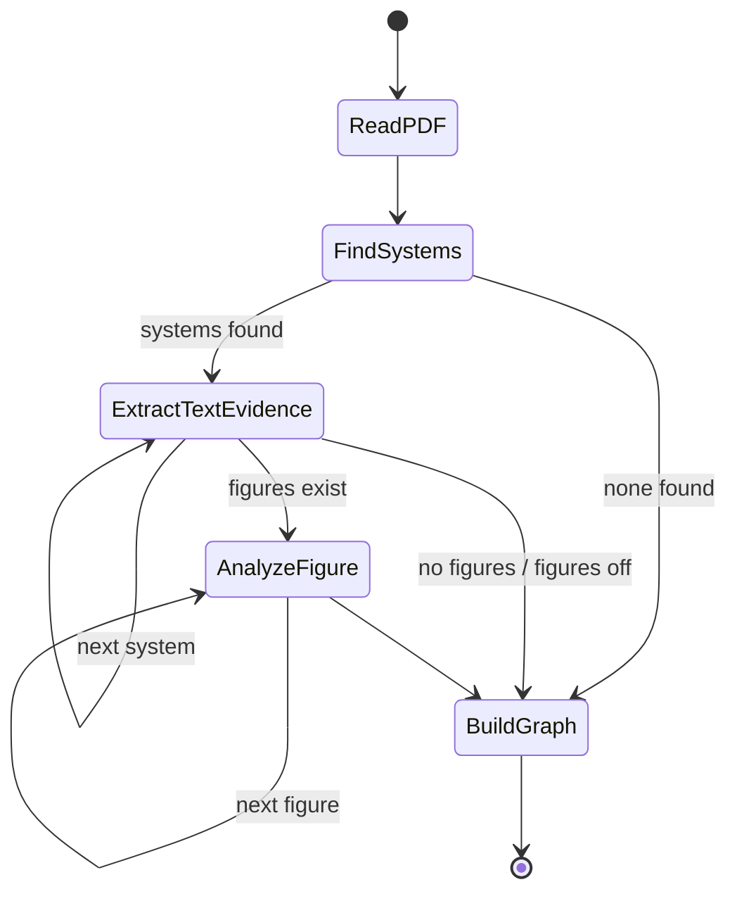
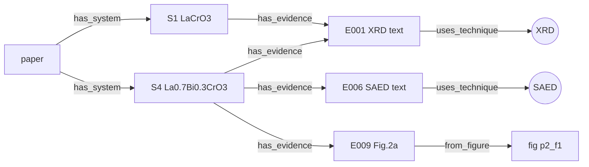

# Task 1: Paper summarizer with pydantic-graph + OpenAI

*Branch `ankit/task1-paper-summarizer`. Written for teammates who are new to Pydantic,
pydantic-ai and pydantic-graph.*

---

## 1. What it does, in one paragraph

A scientist uploads a PDF on a web page. The program finds **every material system** the paper
evaluated (each composition, phase or sample). For each system it collects what the **text**
says and what the **figures** show, and files every fact as an **evidence item** tagged with its
experimental technique (XRD, TEM, XPS, …), the systems it concerns, the numbers, the
instrument conditions, a verbatim quote and the figure image. Everything is saved as a
**knowledge graph** (`paper_graph.json`) plus one file per technique
(`evidence_by_technique/XRD.json`, …). A later specialist agent (say, an XRD-analysis agent)
can load just its technique's file and do deeper analysis for structure generation.

---

## 2. The three tools, explained simply

### 2.1 Pydantic: "data with a shape"
A Pydantic model is a Python class that describes what some data must look like:

```python
class Measurement(BaseModel):
    quantity: str          # required text
    value: str
    unit: str | None = None  # optional
    approximate: bool = False
```

`Measurement(quantity="a", value="5.48", unit="Å")` works.
`Measurement(value=5.48)` raises an error because `quantity` is missing. Pydantic can also turn a
model into **JSON** and back (`model_dump_json`, `model_validate_json`), and it can describe the
shape as a **JSON schema**. That last ability is what lets us tell an LLM exactly what to return.

All our models are in [`src/paper2structure/summarizer/schemas.py`](../src/paper2structure/summarizer/schemas.py).

### 2.2 pydantic-ai: "an LLM call that returns a Pydantic object"
An `Agent` combines **instructions** (the system prompt) with an **output type** (a Pydantic model):

```python
system_finder = Agent(None, output_type=SystemsOutput, instructions="List every material system...")
result = await system_finder.run(paper_text, model="openai:gpt-5.4-mini")
result.output            # a SystemsOutput object, already validated
```

Behind the scenes pydantic-ai:
1. sends the instructions, your message and the JSON schema of `SystemsOutput` to OpenAI;
2. receives the model's JSON answer;
3. validates it. If a field is missing or has the wrong type, it sends the error back to the
   model and asks again (up to `retries` times).

On top of that we add our own check, an **output validator**. The validator for text and figure
evidence makes sure every `system_ids` value is a real ID (S1…Sn). If the model invents "S7", we
raise `ModelRetry("Unknown system_ids ['S7']…")` and the model has to fix its answer.

The model name is chosen **at run time**, not inside the agent. The same code can therefore run
on OpenAI, another provider, or a fake model.

Agents are in [`agents.py`](../src/paper2structure/summarizer/agents.py).

### 2.3 pydantic-graph: "a flowchart you can run"
A long job is easier to understand, debug and extend if it is split into named **steps (nodes)**.
In pydantic-graph each step is a class with a `run` method that **returns the next step**:

```python
@dataclass
class FindSystems(BaseNode[SummarizerState, SummarizerDeps, PaperGraph]):
    async def run(self, ctx) -> ExtractTextEvidence | BuildGraph:
        ...
        if not ctx.state.systems:
            return BuildGraph()            # nothing found: skip ahead
        return ExtractTextEvidence(index=0)
```

- The **return type hint** (`-> ExtractTextEvidence | BuildGraph`) is how the library learns the
  arrows of the flowchart. It is required, not just documentation.
- `ctx.state` is a shared notebook that every step reads and writes (systems found so far,
  evidence so far, token counts).
- `ctx.deps` holds fixed settings (which model to use, where to send progress messages).
- Returning `End(value)` finishes the graph.
- A step can return **itself** with a new field value (`ExtractTextEvidence(index=self.index + 1)`).
  That is how we loop over systems and figures.

The graph is in [`graph.py`](../src/paper2structure/summarizer/graph.py). You can print it at any time:

```bash
.venv/bin/paper-summarizer --show-graph
```

> **Version note.** We use pydantic-ai / pydantic-graph **2.59**. In this version graphs are
> assembled with `GraphBuilder` (older tutorials use `Graph(nodes=[...])`, which no longer
> exists). Our `BaseNode` classes are plugged in with `builder.node(MyNode)`, and the first node
> is passed as `inputs=ReadPDF()` when running.

---

## 3. The workflow



| Step | LLM? | What it does | Writes to state |
|---|---|---|---|
| `ReadPDF` | no | Text per page plus figure images with captions ([`pdf_reader.py`](../src/paper2structure/summarizer/pdf_reader.py)) | `document` |
| `FindSystems` | 1 call | Paper metadata and the list of distinct material systems; code assigns S1…Sn | `metadata`, `systems` |
| `ExtractTextEvidence` | 1 call **per system** | Synthesis, structure claims and per-technique evidence for the target system | `systems[i].synthesis/structure`, `evidence` |
| `AnalyzeFigure` | 1 vision call **per figure** | Panels: technique, systems, axes, values read off the plot (`approximate=True`), observations | `evidence` |
| `BuildGraph` | no | Merges duplicate evidence, builds nodes/edges, writes all files ([`knowledge_graph.py`](../src/paper2structure/summarizer/knowledge_graph.py)) | returns `End(PaperGraph)` |

**Why a separate call per system?** One giant "extract everything" call tends to blur systems
together and skip the less prominent ones. A focused question ("only about S3") gives more
complete answers. The cost is repeated series-wide facts, which `merge_duplicate_evidence`
removes (same technique and same quote → one item whose `system_ids` is the union).

**Why figures at all?** In our test paper, per-composition lattice parameters exist **only in
Fig. 2**. The text gives trends only. See [`experiments/claude_manual/README.md`](../experiments/claude_manual/README.md).

**Error handling.** If one system's or one figure's LLM call fails, the error is recorded in
`errors.txt` and the graph carries on. A non-technical user still gets a partial result instead
of a crash.

### 3.1 How figures are found
Papers contain two kinds of figures, and we handle both:
- **raster images** (micrographs, photos), found with `page.get_images()`;
- **vector drawings** (most plots), found with `page.cluster_drawings()`, which groups nearby
  lines and curves.

Rectangles that touch are merged, tiny ones (< 40 pt) are dropped, each region is rendered at
200 dpi, and the nearest "Fig. N" caption is attached. A caption below the figure in the same
column is preferred. Body sentences like "Fig. 1 shows…" are not treated as captions. Text that
lies inside a figure (axis ticks) is removed from the page text so it does not confuse the LLM.

---

## 4. The data model (what is saved)

```
PaperGraph
├── metadata: PaperMetadata         title, authors, doi, year, summary
├── systems: [MaterialSystem]       S1…Sn
│     ├── name, family, composition_variables {x: "0.2"}, material_class, form
│     ├── synthesis: method, precursors, conditions
│     └── structure: crystal_system, space_group, lattice_parameters[Measurement], site_occupancy, phase_purity
├── evidence: [Evidence]            E001…
│     ├── system_ids ["S1","S2"]    which systems this applies to
│     ├── technique "XRD", technique_category "diffraction"
│     ├── source_type "text"|"figure", source_ref "page 2" / "Fig. 2 panel a (page 2)"
│     ├── summary, measurements[Measurement], conditions, observations, quote
│     └── image_path                figure PNG, for figure evidence
├── nodes: [GraphNode]              paper / system / evidence / technique / figure
└── edges: [GraphEdge]              has_system, has_evidence, uses_technique, from_figure
```

Graph shape:



`Measurement.value` is a **string** on purpose. Papers write "~1", "5.48(2)" and "10-110", and
converting those to numbers too early loses information. The downstream agent decides how to
parse them. `approximate=True` marks numbers read off a plot by eye.

### 4.1 How the next agent uses it

```python
from paper2structure.summarizer.knowledge_graph import load_graph

g = load_graph("outputs/my_paper/paper_graph.json")
for ev in g.evidence_for(technique="XRD"):           # or category="diffraction", system_id="S3"
    print(ev.system_ids, ev.summary, ev.conditions, ev.image_path)
```

Or simply give it `evidence_by_technique/XRD.json`, which already contains the paper metadata,
the relevant systems with their structure claims, and all XRD evidence items with image paths.

---

## 5. Running it

### 5.1 One-time setup
```bash
cd hackathon/paper2structure
curl -LsSf https://astral.sh/uv/install.sh | sh      # installs uv (Python/package manager)
uv venv --python 3.12 .venv                          # project needs Python ≥ 3.12
uv pip install --python .venv -e .                   # installs the package + dependencies
cp .env.example .env                                 # then put your OpenAI key in .env
```
`.env` is in `.gitignore`. **Never commit API keys.**

### 5.2 Free test first (no API key, no cost)
```bash
.venv/bin/paper-summarizer ../papers/La1-xBixCrO3_arXiv1403.3526.pdf --model dry-run --out outputs/dryrun
```
`dry-run` is a fake model that returns canned answers. It checks that PDF reading, the graph,
validation and file writing all work.

### 5.3 Real run
```bash
.venv/bin/paper-summarizer path/to/paper.pdf                 # model from .env (P2S_MODEL)
.venv/bin/paper-summarizer paper.pdf --no-figures            # cheaper: text only
.venv/bin/paper-summarizer paper.pdf --model openai:gpt-5.4  # bigger model
```

### 5.4 Web page
```bash
.venv/bin/streamlit run app/streamlit_app.py
```
VS Code forwards the port, so open the link it prints. The page has an upload box, live progress
messages, a table of systems, evidence grouped by technique with figure thumbnails, the
knowledge-graph picture and download buttons. Previous results can be reopened from the sidebar.

### 5.5 Cost
For an N-system paper with F figures there are `1 + N + F` LLM calls. Each text call sends the
whole paper, so a 10-page paper with 5 systems and 8 figures makes 14 calls of roughly 10-20k
input tokens each. The token totals are printed at the end of every run. Use `--no-figures` or a
`-mini` model while developing.

---

## 6. File map

```
src/paper2structure/summarizer/
  schemas.py          Pydantic models (LLM outputs + saved data)
  pdf_reader.py       PDF → text + figure PNGs + captions (PyMuPDF)
  agents.py           3 pydantic-ai agents + ID validators
  graph.py            pydantic-graph workflow (5 nodes) + summarize_paper()
  knowledge_graph.py  build nodes/edges, merge, save JSON/MD/DOT, load_graph()
  models.py           pick model from .env; "dry-run" fake model
  cli.py              command line: paper-summarizer
app/streamlit_app.py  web interface
experiments/claude_manual/   the same flow done by hand by Claude (reference answer)
docs/task1_pydantic_report.md  this file
.env.example          template for API key settings
```

---

## 7. Known limitations and next steps

1. **Structure claims come from the text only.** Fig. 2 lattice values end up as figure
   evidence, not in `system.structure.lattice_parameters`. Next step: add a
   `ConsolidateStructure` node after `AnalyzeFigure` that merges text and figure values per
   system and flags conflicts (for example SAED 5.48 Å vs XRD 5.492 Å).
2. **Tables** are read as plain text. PyMuPDF has `page.find_tables()`, which could give the LLM
   clean tables.
3. **Very long papers / supplementary info.** The whole text is sent on every per-system call.
   For 30+ pages, send only the sections that mention the system.
4. **Values read from plots are approximate.** They are flagged, but a dedicated digitizer
   would be more precise.
5. **Parallelism.** Figures are analysed one after another. pydantic-graph's `GraphBuilder`
   supports fan-out/join (`.map()`), which could run them in parallel.
6. **No automated scoring yet.** `experiments/claude_manual/output/paper_graph.json` can act as a
   reference answer for a simple evaluation script.

---

## 8. Glossary

| Term | Meaning |
|---|---|
| Agent | An LLM plus instructions plus an expected output shape |
| Node / step | One box in the flowchart; a `BaseNode` subclass |
| State | Shared notebook passed through all steps (`SummarizerState`) |
| Deps | Fixed settings passed to all steps (`SummarizerDeps`) |
| Schema | Description of a data shape; Pydantic generates it from a model class |
| Validator | Code that checks an LLM answer; `ModelRetry` asks the model to try again |
| Evidence item | One fact from one technique and one source (text or a figure panel) |
| Knowledge graph | Nodes (paper, systems, evidence, techniques, figures) joined by labelled edges |
| Dry run | Running with a fake model, to test plumbing for free |
| `.env` | Local file of secrets/settings, never committed |
